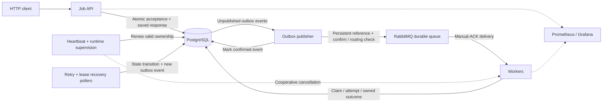
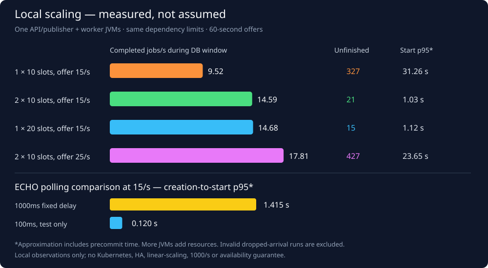

# Distributed Job Processing Platform

A Java backend for durable asynchronous jobs: accept work through HTTP, publish
through RabbitMQ, and track execution, retries, and crash recovery in PostgreSQL.
Built to explore distributed-systems correctness with real dependencies, explicit
failure tests, and reproducible local scaling experiments—not production claims.

**Stack:** Java 21 · Spring Boot 3.5.16 · PostgreSQL 17.6 · RabbitMQ 4.1.8 ·
Maven 3.9+ · Flyway · Testcontainers · Prometheus / Grafana · Docker Compose.

## What it implements

- **Durable acceptance:** job, payload, outbox event, and saved HTTP outcome commit
  in one PostgreSQL transaction before returning `202 Accepted`.
- **Request idempotency:** matching keys/input replay the original response;
  changed input returns `409`. Single submissions, batches, and manual retries
  use scoped keys with database-enforced concurrency control.
- **Confirmed publication:** persistent messages, durable RabbitMQ topology,
  publisher confirms, and routing checks; uncertain publication can duplicate.
- **Ownership-safe workers:** atomic claim plus attempt creation, short row locks,
  and manual ACK after a committed outcome or authoritative duplicate/stale check.
  Attempt ownership and fresh database time reject stale writes.
- **Bounded retries and recovery:** four attempts per cycle, 1/2/4-second backoff,
  a 30-second lease, 10-second heartbeats, and a five-minute per-attempt runtime.
  Manual retry preserves lifetime history; cancellation is cooperative.
- **Observable execution:** JSON lifecycle logs, bounded-label metrics, cached
  database snapshots, and a provisioned Grafana dashboard. `ECHO` and cancellable
  `SIMULATED_WORK` handlers keep workload behavior explicit.

## Architecture



PostgreSQL is the source of truth; RabbitMQ carries job references, not the job
ledger. Handlers run outside database transactions. API/publisher/poller and
worker roles can run in separate processes using the same application JAR.
See the [code-linked correctness walkthrough](docs/implementation-review.md)
for transaction boundaries, duplicate windows, and failure traces.

## Measured local scaling

Recorded on **2026-10-25**: each comparison offered **15 jobs/s for 60 seconds**,
using the same **1000ms, no-failure simulation** and a separate API/publisher JVM.

| Workers × execution slots | Offered jobs/s | Completed jobs/s¹ | Unfinished at window end |
| --- | ---: | ---: | ---: |
| 1 × 10 | 15 | 9.52 | 327 |
| 2 × 10 | 15 | 14.59 | 21 |
| 1 × 20 | 15 | 14.68 | 15 |

¹ Completion rates use the observed database windows (approximately 60 seconds);
later drain completions are excluded. Unfinished includes queued and running jobs.



More execution slots reduced backlog for this workload; one twenty-slot worker
performed similarly to two ten-slot workers. Adding processes also added heap,
threads, connection pools, and potential CPU use: this was **not** a constant-total-
resource comparison. All processes shared one development host.

The [measured report](docs/benchmarks/2026-10-25-scaling.md) includes resources,
drain times, connection costs, overloaded cases, and **invalid runs**, including
generator drops. First-start delay is a creation-to-first-claim approximation,
not exact commit-to-start timing. These short local runs establish neither
maximum capacity, **1,000 jobs/s**, nor **99.9% availability**.

## Quick start

From an existing checkout, use **JDK 21**, **Maven 3.9+**, and running Docker with
Compose v2. Check `java -version` and `mvn -version` use the same JDK. Default
ports: 5432, 5672, 15672, and 8080. Do not launch a second app on port 8080.

```sh
docker compose up -d --wait postgres rabbitmq
SERVER_ADDRESS=127.0.0.1 MESSAGING_ENABLED=true mvn spring-boot:run
```

The explicit loopback binding is recommended: **the API has no authentication**.
Plain startup defaults to `MESSAGING_ENABLED=false`; jobs can be accepted, but
execution and retry/recovery polling wait until messaging is enabled.

In a second terminal, check health and submit one job:

```sh
curl --fail-with-body http://localhost:8080/actuator/health
curl --fail-with-body -i http://localhost:8080/jobs \
  -H 'Content-Type: application/json' \
  -H 'Idempotency-Key: readme-demo-1' \
  -d '{"type":"ECHO","payload":{"message":"hello"}}'
```

Expect `202` with a `jobId` and `Location` header. Replace `REPLACE_WITH_JOB_ID`
below with that returned UUID; repeat GET until `COMPLETED` to inspect the result.

```sh
curl --fail-with-body http://localhost:8080/jobs/REPLACE_WITH_JOB_ID
```

Repeating the POST with the same key/input returns the **original 202 and job ID**,
even after completion; it does not rerun the job. GET shows current state. Changed
input with that key returns `409`; genuinely new work needs a new key.

See the [API contract](docs/api.md) for batches, simulation payloads, and manual
retry. For macOS Java selection, configuration, health/readiness meanings,
monitoring, containers, and safe stopping, use the
[local development guide](docs/local-development.md).

## Build and verify

```sh
mvn verify
python3 -m unittest discover -s tools -p 'test_*.py' -v
```

Docker is required for Java integration tests: Testcontainers starts disposable
**real PostgreSQL and RabbitMQ**, not H2 or the persistent development services.
Python 3.9+ is required for the tooling tests and experiment runners.

**Latest local verification: 2026-10-26 — 173 Java tests and 79 Python
tests passed**, with no failures/errors/skips. Coverage includes concurrent
idempotency, rollback, confirms/redelivery, stale ownership, lease renewal,
runtime cancellation, dependency outages, recovery after a worker JVM kill, and
public-file/link checks. The 79 Python tests include eight publication-guard checks
in addition to the earlier 71 tooling tests. These are local results, not hosted CI.

**[GitHub Actions workflow](.github/workflows/ci.yml):** check the first hosted run after publication; configuring a
workflow alone is not evidence of passing CI. No remote-CI status is claimed here.

## Explore the implementation

| Read next | Focus |
| --- | --- |
| [Correctness walkthrough](docs/implementation-review.md) | Code, SQL, schema, concurrency, and failure scenarios |
| [Interactive explorer](docs/implementation-explorer.html) | Illustrated acceptance, replay, retries, crashes, and uncertain commits |
| [Local development](docs/local-development.md) | Run, configure, test, monitor, and stop safely |
| [API](docs/api.md) · [Messaging](docs/messaging.md) · [Reliability](docs/reliability.md) | Contracts, confirms/ACK rules, leases, and retry cycles |
| [Observability](docs/observability.md) | Metric/log meanings, dashboard, and measurement limits |
| [Performance method](docs/performance.md) · [Baseline report](docs/benchmarks/2026-10-25.md) | Fixed-rate load and real dependency outages |
| [Scaling guide](docs/scaling.md) · [Scaling report](docs/benchmarks/2026-10-25-scaling.md) | Role separation, resource costs, and container verification |
| [Design](docs/design.md) · [Review decisions](docs/design-review.md) · [Progress](docs/progress.md) | Rationale and implementation history |

GitHub normally shows the explorer's HTML **source**, not the interactive page.
Open it from your checkout in a browser, or download the raw file and open it
locally. It is a self-contained illustration, not a live dashboard or API client.

## Project layout

- [src/main/java/com/sahil/jobplatform](src/main/java/com/sahil/jobplatform) — API, persistence, messaging, reliability, and observability.
- [src/main/resources](src/main/resources) — application settings and Flyway migrations.
- [src/test/java](src/test/java) — unit and real-dependency integration tests.
- [tools](tools) — isolated benchmark, scaling, container-smoke runners, and their tests.
- [docker](docker) — broker and monitoring configuration.
- [.vscode/tasks.json](.vscode/tasks.json) — existing local tasks, including macOS Java 21 selection.

## Scope, security, and limitations

- **Local development only:** no authentication or tenant isolation; all callers
  share `local-client`. Bundled passwords are explicit development placeholders,
  not production secrets. Do not expose the API, broker, database, or monitoring
  services publicly; production security and secrets management are not supplied.
- **At-least-once, not exactly-once:** duplicate publication/redelivery is expected.
  Ownership protects stored state, not arbitrary external business effects.
- **Single-host durability, not HA:** recovery assumes durable data survives and
  dependencies return. No multi-host redundancy, Kubernetes, autoscaling,
  permanent-storage-loss recovery, long soak, or availability guarantee is claimed.
- **Retention is unbounded:** no automatic cleanup of jobs, attempts, results,
  outbox events, or idempotency records. Named volumes are not backups.

No reuse license has been selected. Public visibility does not grant a license;
normal copyright protections apply.
Read [SECURITY.md](SECURITY.md) for known deployment boundaries and private
reporting guidance, and [CONTRIBUTING.md](CONTRIBUTING.md) for verification rules.