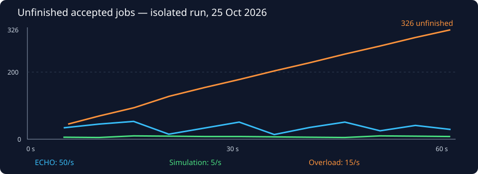

# Local benchmark results — 2026-10-25

**Conclusion:** the platform accepted and completed these bounded workloads
correctly, but fast acceptance did **not** prevent overload. One ten-slot worker
could not keep up with fifteen one-second jobs per second.

## Final run

Run ID: `bench-6b658cf7-aa63-46ff-808e-68c0443790ea`, starting 08:51:02 UTC.
Method and repeat instructions: [performance guide](../performance.md).
Machine-readable retained summary: [2026-10-25-summary.json](2026-10-25-summary.json).

Each row offered work for **60 seconds**, after a separate ten-second drained
warm-up. All measured submissions were new, single-job requests, not replay or
batch requests. All **4,200 measured jobs** completed with exactly one attempt
and the expected result; there were no HTTP errors, missing arrivals, generator
drops, unknown commits, retry attempts or terminal failures. An additional 200
warm-up jobs were retained during the disposable run and excluded from samples.

| Workload | Offered/s | Accepted | Completed during DB window | Measured completions/s | Client acceptance p99 | Unfinished at window end | Additional observed drain |
| --- | ---: | ---: | ---: | ---: | ---: | ---: | ---: |
| ECHO, fixed 128-character message | 50 | 3,000 | 2,971 | 49.39 | 22.07 ms | 29 | 0.37 s |
| One-second simulation, no failures | 5 | 300 | 292 | 4.86 | 55.50 ms | 8 | 2.33 s |
| **Overload**, same simulation | 15 | 900 | 574 | 9.55 | 144.48 ms | **326** | **34.90 s** |

The database completion windows were 60.158383, 60.109579 and 60.115453 seconds,
respectively. They are explicitly reported rather than divided by a convenient
nominal 60 seconds. Drain checking has two-second resolution plus observation
overhead; a fast first check may finish sooner than that. It is not a final-ACK
timestamp. All remaining work completed before the 120-second drain deadline.

## Timing detail

| Workload | Scheduled-arrival-to-response p99 | Dispatch lag p99 | Creation-to-first-start p95 / p99, approximate | Approximate starts within 5s | Recorded attempt p50 / p99 |
| --- | ---: | ---: | ---: | ---: | ---: |
| ECHO | 26.04 ms | 5.19 ms | 1.121 / 1.184 s | 100% | 6.47 / 21.06 ms |
| Simulation 5/s | 59.10 ms | 7.36 ms | 1.002 / 1.036 s | 100% | 1.023 / 1.130 s |
| Overload 15/s | 145.86 ms | 8.39 ms | **31.582 / 32.948 s** | **13.11%** | 1.019 / 1.113 s |

First-start timing uses database creation, **including acceptance precommit time**,
to immutable first-attempt start. It is not exact durable-commit-to-start. Every
job in these runs eventually started; the runner does not omit never-started
jobs from the within-five-seconds denominator. Attempt duration includes
platform/persistence overhead and is not CPU time.

The client p99 being below 200ms does not mean every request was below 200ms:
maxima were 78.76ms, 294.87ms and 588.58ms. Each observation is a local sample,
not a universal latency guarantee.

## Conditions and data size

- macOS 14.6 ARM64, eight logical host CPUs, 8 GiB host RAM.
- Docker Desktop engine 28.0.1, eight VM CPUs, 4,109,803,520 bytes VM memory.
- New PostgreSQL 17.6 and RabbitMQ 4.1.8-management containers, each limited to
  **one CPU and 768 MiB RAM**. Disposable storage, random localhost ports.
- Temurin/OpenJDK 21.0.12.1, Spring Boot 3.5.16. Host application JVM with
  256–512 MiB heap and `ActiveProcessorCount=2`; the latter changes JVM ergonomics,
  **not** an OS CPU quota. The Python generator runs on the same host.
- Existing development app/database/broker/Prometheus/Grafana stayed running on
  the same machine, so contention/host scheduling can affect these observations.
- One worker process, ten synchronous consumers/slots, prefetch one each; primary
  DB pool ten, reserved control pool four; publisher batch 100 and fixed delay
  1000ms; lease 30s/heartbeat 10s/runtime five minutes, normal poll defaults.
- ECS INFO lifecycle logs to file and normal periodic observability snapshots
  remained enabled. The benchmark observer sampled SQL and management HTTP about
  every five seconds; that traffic is not free.
- Generator: sixteen HTTP threads, at most 32 outstanding requests, fixed-rate
  arrivals, fresh local TCP connection per request, no TLS.

| Workload | Jobs already stored before measured phase | Initial DB bytes | Final DB bytes | Request JSON bytes | Stored payload/result JSON UTF-8 bytes |
| --- | ---: | ---: | ---: | ---: | ---: |
| ECHO | 100 | 8,522,899 | 14,003,347 | 168 | 143 / 143 |
| Simulation | 3,150 | 14,019,731 | 14,634,131 | 81 | 48 / 82 |
| Overload | 3,500 | 14,658,707 | 15,887,507 | 81 | 48 / 82 |

Each warm-up adds 100 ECHO or 50 simulation jobs. Cases were sequential, not
independently empty databases. Size means `pg_database_size`, including retained
rows, indexes and database overhead—not just live payload size. JSONB text output
includes PostgreSQL's formatting; request JSON is compact. 202 response bodies
were 66 bytes in these single-job runs.

Jar SHA-256: `8e6a47f44b4d06510745b9a6add40c4d357b63f36239888d0110374789bd91fe`.
Runner SHA-256: `22e64d6888442d7575c59def982b17e0a91e856e4c2e79e9fa276c31f8907fa0`.
Raw request/history/snapshot evidence remains under the final run's build-output
directory. The readable summary and chart here are retained outside ignored
build output; they do not contain real payloads, request secrets or credentials.

## What became the bottleneck?

**Overload was worker-service-time limited.** Ten one-second slots cannot sustain
fifteen jobs per second. The database samples showed all ten slots running;
broker snapshots showed ten unacknowledged deliveries and increasing ready work.
Unfinished jobs grew from about 45 near six seconds to 326 at the end. Only 13
were still waiting for publication at the end: most waiting work had already
reached the broker, rather than being stuck solely in the outbox.

ECHO work was short; its approximately one-second first-start delay was consistent
with the configured polling interval and publication bursts. Sampled ECHO
unfinished work mostly sat in the unpublished outbox, while workers were usually
idle at the five-second observation instants. This is evidence of polling wait
at 50/s, **not** proof that the database, CPU, or broker has unlimited capacity.
No CPU/flamegraph profile or maximum-throughput sweep was performed.

A single publisher with batch 100 and one-second **fixed delay after each batch**
has a configuration-derived steady bound below 100 publications/s once batch
time is included. That bound is not a measured ceiling, but it already prevents
claiming 1,000/s sustainable end-to-end progress under these defaults.

## Target review

| Design target | Honest outcome |
| --- | --- |
| 1,000 newly accepted jobs/s | **Not demonstrated**: highest ECHO offer was 50/s; no 1,000/s client test. Default publisher/one-second worker capacity is insufficient for 1,000/s sustainable processing |
| Acceptance p99 below 200ms | **Observed at these offered rates only**: all three local client p99 samples were below 200ms, with zero reported errors/drops |
| 95% begin within roughly five seconds | Baselines had 100% within five seconds using the explicit creation-time approximation; overload had only 13.11%. **Not a system-wide guarantee**, and exact commit-to-start is unmeasured |
| 99.9% availability | **Unmeasured**; one-minute runs and controlled outages cannot establish this |
| No lost accepted work after transient service return | Demonstrated in these controlled intact-storage scenarios; not permanent loss, arbitrary partition or HA proof |

## Repetition and measurement development

An earlier full qualification run, `bench-bebfc84d-e43e-4f36-bfc2-25fc6b8b5cea`,
used the same application/default limits and workloads. It recorded ECHO 49.83/s,
simulation 4.90/s, overload 9.48/s, and 331 unfinished overloaded jobs draining in
36.71s. It also completed all 4,200 measured jobs without errors or wrong results.

The final runner moved observer work off the arrival thread, rechecked deadlines
at actual dispatch, and added cleanup/reporting guards. Thus the runs show the
same qualitative bottleneck, **not** a controlled performance improvement
comparison. Do not attribute their p99 difference to an application change; the
application JAR hash was identical and the generator/host timing differed.

An initial ECHO-only qualification attempt hit a Python 3.9 timestamp-format
compatibility error during reporting. It was not retained as a valid benchmark;
the parser was fixed/tested and the complete suites above were rerun. All owned
containers were cleaned after that failed attempt too.

## Separate outage/failure evidence

Full regression: **173 Java tests** passed, zero failures/errors/skips. Python
runner: **10 tests** passed. Three new tests controlled real disposable services:

| Scenario | Confirmed-stop-to-restored-check time | Return-to-final-assertions time | Result |
| --- | ---: | ---: | --- |
| Broker application outage | 2.352s | 3.807s | API accepted/replayed 202; unpublished outbox waited; prior durable queue item and new work completed once; automatic reconnect |
| Database acceptance outage | 2.730s | 0.339s | POST/GET/readiness 503; no rejected-request job/key persisted; same-key retry after return accepted once |
| Database outage with active attempt | 2.610s | 8.413s | Uncertain supervisor cancelled waiting/paused intake; lease expired; EXPIRED then COMPLETED, one result, stale writes rejected |

These timings include control/readiness/assertion overhead and use **shortened
test settings**, described in the [method guide](../performance.md). They are
not production-default recovery bounds. Existing actual killed-worker,
duplicate-redelivery, timeout and primary-pool-starvation tests also passed.

All experiment containers/temporary volumes were removed. The development app
and monitoring remained healthy with its original **7 COMPLETED / 2 FAILED**
jobs unchanged. No production implementation or schema migration changed in this
phase. No multi-worker scaling, Kubernetes, long soak or availability certification
was performed.