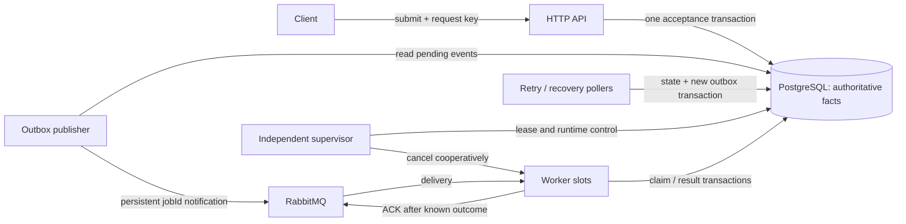
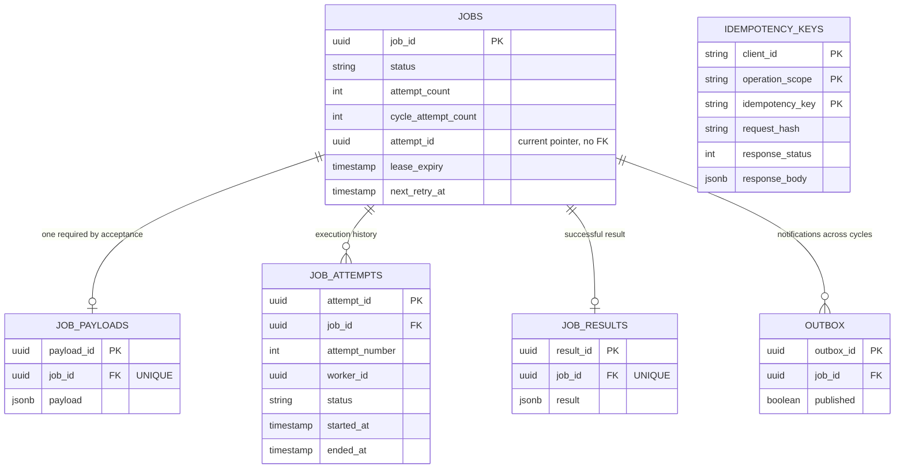
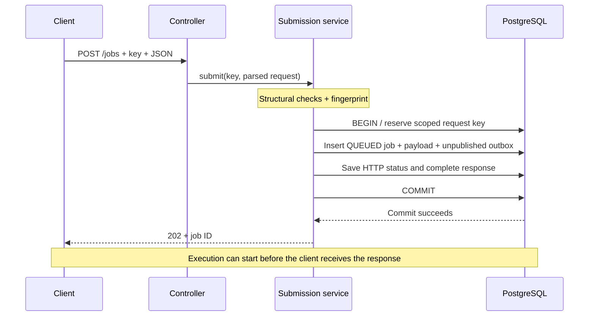
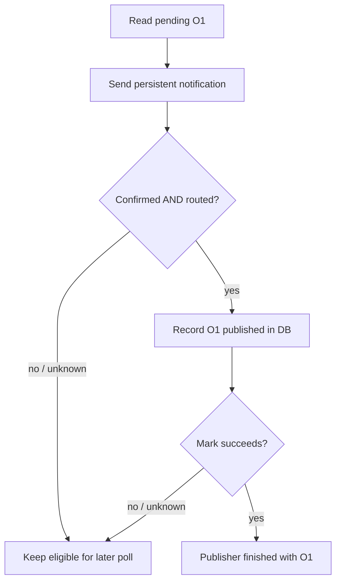
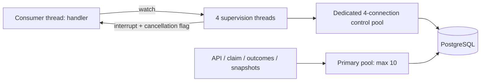
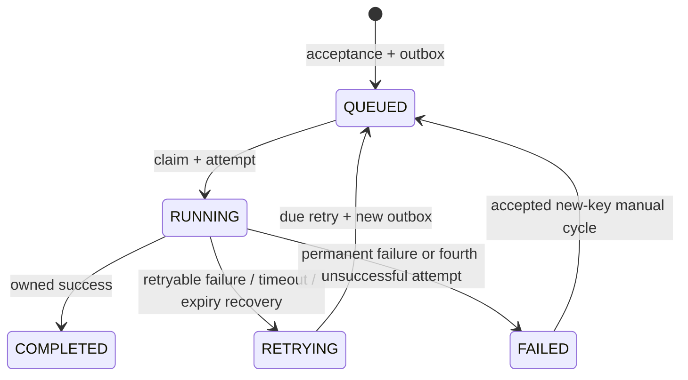
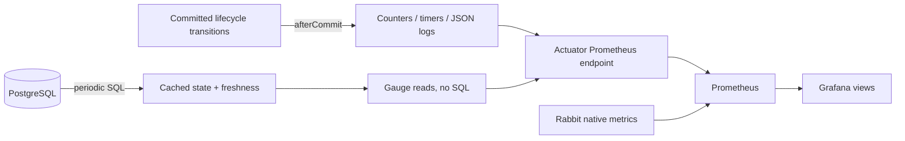

# Understand the implementation: a guided review

**Reviewed against the current code on 2026-10-25.** This is a teaching guide, not
a new feature or a claim that reading it proves understanding. No live job needs
to be submitted to follow the examples. Symbols such as J1/A1 below are short
teaching names; actual IDs are UUIDs.

Open [the interactive visual walkthrough](implementation-explorer.html) in a
browser. Its steps are **illustrations**, not live telemetry; they cannot submit,
cancel or modify real jobs. Use Markdown Preview for the Mermaid diagrams here.

## Learning route

Read one chapter, follow its code links, then answer its checkpoint aloud. Do
not try to memorize every class before understanding the path of one job.

| Pass | Question | Chapters |
| --- | --- | --- |
| 1 — Big picture | What problem is this solving, and who owns which facts? | 1–3 |
| 2 — Follow one job | How does HTTP become a durable job, notification, attempt and result? | 4–8 |
| 3 — Break the happy path | What if requests/messages repeat, workers crash or DB access is uncertain? | 9–12 |
| 4 — Explain the choices | Why these transactions, SQL predicates, resources and tools? | 13–16 |
| 5 — Connect evidence | What is tested/measured, and what does that not prove? | 17–19 |

**Code review navigation:** [acceptance](../src/main/java/com/sahil/jobplatform/api/JobSubmissionService.java),
[execution SQL](../src/main/java/com/sahil/jobplatform/messaging/JobExecutionStore.java),
[worker](../src/main/java/com/sahil/jobplatform/messaging/JobWorker.java),
[supervisor](../src/main/java/com/sahil/jobplatform/messaging/AttemptSupervisor.java),
[schema](../src/main/resources/db/migration/V2__create_job_persistence.sql).

---

## 1. What did we build?

An HTTP service accepts work now and processes it later. The client need not keep
its connection open while work waits or retries.

Example input:

```json
{"type":"SIMULATED_WORK","payload":{"durationMillis":1000,"failFirstAttempts":2}}
```

This means: each attempt waits approximately one second; attempts one and two in
the current cycle deliberately fail; attempt three succeeds if infrastructure and
ownership checks allow it. The platform—not the handler—schedules later attempts.

The client supplies an `Idempotency-Key`, receives `202` plus a job ID after the
acceptance commit, and uses GET for progress/result. **202 means accepted, not
executed, successful, or guaranteed to finish within a deadline.**

Current handlers are deliberately small:

- `ECHO`: return the stored payload unchanged.
- `SIMULATED_WORK`: cancellable waiting with predictable per-cycle failures.

They teach distributed coordination without hiding behavior inside real payments,
emails or remote APIs. There is no external business side effect in these handlers.

**Checkpoint:** Can the API return 202 while RabbitMQ is down? **Yes**, if its
database acceptance transaction commits; execution waits for publication/recovery.

## 2. System design: logical roles, not mandatory microservices



**PostgreSQL is the source of truth. RabbitMQ is a delivery mechanism.** A message
says “look at job J1”; it is not permission to execute J1 without checking the DB.

These roles can share one application process. They can also be configured into
an API/publisher process and several worker processes using the **same JAR**.
This is not a collection of separate microservice codebases. Split workers still
contain the HTTP/API application; their ports need not be exposed.

| Component | Responsibility | Does not decide |
| --- | --- | --- |
| API | Validate, identify request, commit accepted work/outcome | Whether an old worker still owns an attempt |
| PostgreSQL | Serialize and store durable state changes | Physically stop arbitrary Java code |
| RabbitMQ | Buffer/deliver persistent notifications, track ACKs | Current job status or retry eligibility |
| Publisher | Bridge durable outbox rows into RabbitMQ | Execute handlers |
| Worker | Claim, run handler, record owned outcome | Skip lease checks because it received a message |
| Supervisor | Renew/check ownership, enforce runtime, request cancellation | Promise a stuck external action stopped |
| Retry/recovery | Make eligible retries/abandoned claims progress | Guarantee business success |
| Prometheus/Grafana | Observe/explain behavior | Authorize claims or ACKs |

**Why both DB and broker?** DB transactions let us coordinate jobs, requests and
attempts. A broker gives buffered worker delivery and consumer flow control. A
DB-only queue is another valid architecture, but replacing the approved stack is
not necessary for this learning implementation.

## 3. Understand the identities and data model first

### Different names answer different questions

| Name | Example | Question answered |
| --- | --- | --- |
| Request key | `lesson-submit-1` | Is this HTTP operation a repeat? |
| Job ID | J1 | Which accepted unit of work is this? |
| Outbox ID | O1, O2 | Which publication event is being retried/recorded? |
| Attempt ID | A1, A2 | Which execution currently has permission to write? |
| Worker ID | W1 | Which worker instance claimed the attempt? |
| Correlation ID | Fresh on every send | Which publisher confirm belongs to this send? |
| Delivery tag | Channel-local number | Which Rabbit delivery is being ACKed/rejected? |

One job can have many attempts, outbox events and saved manual-retry request
outcomes. **A job ID is not an attempt ID, and a request key is not a job ID.**

### The six tables



`idempotency_keys` is separate: it stores a **request outcome**, possibly a batch
response with many jobs, not a single required job foreign key.

Source: [V2 migration](../src/main/resources/db/migration/V2__create_job_persistence.sql).

Why separate payload from the current job row? Input has a different responsibility
from frequently changing progress/ownership. Summary queries do not need payloads,
and results/attempt history have their own lifecycle. The payload's unique job
reference is the single association: we avoid a second `jobs.payload_id` pointer
that could disagree with it. This is deliberate modeling, not a claim that more
tables automatically improve every query's performance.

| Protection | Why |
| --- | --- |
| Unique payload/result `job_id` | At most one payload/result per job |
| Unique `(job_id, attempt_number)` | No duplicate lifetime history position |
| Partial unique running-attempt index | At most one recorded RUNNING attempt per job |
| Scoped request-key primary key | Concurrent matching requests coordinate in the DB |
| Valid status/counter checks | Reject impossible values even if code makes a mistake |
| Unpublished-outbox partial index | Avoid scanning published history for each publisher batch |
| Status/retry and lease indexes | Support candidate lookup for due/expired work |

The DB uniqueness constraint gives **at most one**, not “every job necessarily has
a payload.” Atomic acceptance supplies that existence. The current attempt pointer
has no FK; transactional code enforces its relationship. Constraints are guardrails,
not a complete state-machine proof and not proof an old process stopped.

**Checkpoint:** Why not a unique outbox `job_id`? Because retries need new
notifications for the same job.

## 4. Acceptance: one durable promise



Read [JobController](../src/main/java/com/sahil/jobplatform/api/JobController.java),
then [JobSubmissionService.execute()](../src/main/java/com/sahil/jobplatform/api/JobSubmissionService.java#L85-L128),
then [JobPersistenceService.createJob()](../src/main/java/com/sahil/jobplatform/persistence/JobPersistenceService.java#L34-L62).

The controller is not the transaction boundary. `TransactionTemplate` opens a
READ COMMITTED transaction; the persistence bean's `@Transactional` method joins
it using REQUIRED propagation. Returning from the transaction callback is followed
by commit; the HTTP result is returned only after `execute()` finishes.

Inside the transaction:

1. Reserve request identity.
2. Validate this new operation.
3. Persist job/payload/outbox.
4. Finalize saved response.
5. Commit all or roll back all.

JPA `flush()` sends SQL but **does not commit**. A later outbox or response-write
failure can still roll back already-flushed jobs. JDBC and JPA participate in the
same primary transaction on this path, rather than separately committing.

**Why not return 202 first?** A crash immediately afterward would leave the client
holding an accepted ID with no durable work. **Why not hold this transaction until
the job finishes?** It would hold connections/locks through long work and defeat
asynchronous acceptance.

## 5. Request idempotency: repeat safely, including concurrent requests

Suppose the client times out after sending J1. It cannot know whether acceptance
committed. Retry with the **same key and input**. A new key means a new operation.

Identity is `(local-client, operation_scope, supplied_key)`, where scope is:

- `SUBMIT_JOB`
- `SUBMIT_BATCH`
- `RETRY_JOB:<canonical job UUID>`

All callers currently share `local-client`; there is no authenticated tenant
namespace. This is a V1 learning choice, not production client isolation.

Actual reservation shape:

```sql
INSERT INTO job_platform.idempotency_keys
    (client_id, operation_scope, idempotency_key, request_hash, response_status, response_body)
VALUES (?, ?, ?, ?, 0, '{}'::jsonb)
ON CONFLICT (client_id, operation_scope, idempotency_key) DO NOTHING;
```

The placeholder is **uncommitted** and finalized before commit; the normal code
does not save a permanent “in progress” response. Schema alone does not forbid a
different buggy writer from committing status zero.

```mermaid
sequenceDiagram
    participant A as Request A
    participant DB as Unique DB key
    participant B as Request B
    A->>DB: Insert same scoped key
    B->>DB: Competing insert waits
    A->>DB: Store work + response, COMMIT
    DB-->>B: Conflict, inserted rows = 0
    B->>DB: New SELECT sees committed response
    Note over B: Same hash: replay; different hash: 409
```

The **unique insert**, not a preliminary SELECT or a Java lock, coordinates
different application instances. If A rolls back, B can become the inserting
owner. READ COMMITTED permits B's new SELECT statement to see A's newly committed
record. We avoid catching a unique-key exception and then querying in an aborted
PostgreSQL transaction.

### What counts as the same input?

[RequestFingerprint](../src/main/java/com/sahil/jobplatform/api/RequestFingerprint.java)
recursively sorts object fields, normalizes exact numbers, serializes and hashes
the full parsed request with SHA-256 and a `v1:` prefix.

| Inputs | Same fingerprint? |
| --- | --- |
| Object fields reordered, different JSON formatting | Yes |
| Numeric `1`, `1.0`, `1e0` | Yes |
| `1` versus string `"1"` | No |
| Missing field versus explicit `null` | No |
| `"hello"` versus `" hello "` | No |
| Array items reordered | No |
| Changed invalid batch item | No |

[JsonConfiguration](../src/main/java/com/sahil/jobplatform/api/JsonConfiguration.java)
preserves large integers/decimals, rejects duplicate JSON keys/trailing values and
uses the same mapper for Hibernate JSON reloads. This avoids silently hashing or
storing a rounded numeric value.

Replay returns the original status/body even after job state changes. It preserves
JSON meaning, not byte-identical field order. **A replayed 202/QUEUED body is not a
current-state query.** Saved well-formed validation/eligibility errors replay too.
Malformed JSON, invalid outer batch structure/key fail before reservation and do
not consume a saved outcome. See [the API contract](api.md) for full distinctions.

No automatic key expiry exists; deleting records loses their protection.

## 6. Batch acceptance and query consistency

Batch input is 1–100 `items`. All items are validated before any job inserts.
Invalid items are rejected individually; valid ones are created together with
the entire ordered per-item response in **one transaction**.

Example: `[valid ECHO, invalid type, valid simulation]` yields two accepted IDs,
one rejection, HTTP 202. If inserting the final valid item fails, **neither valid
job commits**. Partial validation acceptance is not partial per-item commits.
All-invalid but structurally valid input yields a saved/replayable 400.

GET detail uses a read-only REPEATABLE READ transaction across job/payload/history/
outcome queries. This assembles a consistent database snapshot, not a promise the
job cannot change immediately afterward. Result appears only for COMPLETED;
current failure appears for FAILED or automatic RETRYING; full historical errors
remain in attempts. Manual QUEUED/cycle-zero work does not show an old failure as
the new cycle's current failure.

Source: [JobQueryService](../src/main/java/com/sahil/jobplatform/api/JobQueryService.java).
Listing is bounded to the first 1–100 summaries with optional status filter; there
is no cursor pagination. Detail loads all attempts, so lifetime history can grow.

## 7. Why the outbox exists, and why duplicate messages are normal

Naive “commit DB, then send Rabbit” fails if the process dies between those steps.
Naive “send Rabbit, then commit DB” can deliver a job reference whose DB transaction
rolls back. We instead commit **the intention to publish** alongside the job.

[OutboxPublisher](../src/main/java/com/sahil/jobplatform/messaging/OutboxPublisher.java)
polls pending rows oldest-first, max 100 by default:

1. Send persistent `{jobId}` to a durable exchange/queue.
2. Wait for correlated positive publisher confirmation.
3. Check mandatory publishing did not return an unroutable message.
4. Mark the **specific outbox ID** published.

Positive confirm alone is insufficient: a broker may accept a publication that
does not route to the intended queue. Fresh correlation per send distinguishes
concurrent resends of the same event.



There is **no distributed DB/Rabbit transaction**. No DB transaction wraps the
network wait. A DB transaction around send would not make two systems atomic.

Expected duplicate: broker accepted O1 → DB mark failed → publisher sends O1 again.
The worker's DB claim prevents two deliveries from independently owning the same
currently queued execution. Multiple publishers can select the same row, so even
healthy concurrent publishing can duplicate notifications.

A consumer can execute/finish before the publisher records the mark. A message
contains only job ID, not attempt/generation permission; an old delayed notification
can legitimately claim a currently QUEUED later cycle. DB state is authoritative.

## 8. Claim, execute, commit outcome, then ACK

```mermaid
sequenceDiagram
    participant R as RabbitMQ
    participant L as Listener / worker
    participant DB as PostgreSQL
    participant S as Supervisor
    R->>L: Deliver jobId (unacknowledged)
    L->>DB: Lock job, recheck QUEUED, new attempt/counters/lease
    L->>DB: COMMIT claim
    L->>S: Watch this attempt
    Note over L: Handler runs OUTSIDE a DB transaction
    S->>DB: Short ownership/runtime checks; renew when due
    L->>DB: Lock + current token/lease/runtime checks
    L->>DB: Save job + attempt + result; COMMIT
    L->>R: ACK original channel delivery
```

Read in order:
[JobMessageListener.onMessage()](../src/main/java/com/sahil/jobplatform/messaging/JobMessageListener.java),
[JobWorker.process()/execute()](../src/main/java/com/sahil/jobplatform/messaging/JobWorker.java),
[JobExecutionStore.claim()/complete()](../src/main/java/com/sahil/jobplatform/messaging/JobExecutionStore.java#L38-L109).

Claim locks the job with `FOR UPDATE`, checks its state/budget, generates an attempt
UUID, reads fresh DB time, updates RUNNING and both counters, inserts attempt and
reads payload. The Spring transactional bean call commits before it returns to
the worker. Missing job is not the same as DB unavailable: only confirmed absence
can produce the missing decision.

### Two deliveries race

| Moment | Consumer A | Consumer B |
| --- | --- | --- |
| Both see a message for J1 | Obtains J1 row lock | Waits for that row lock |
| A claims | Inserts A1; J1 RUNNING; commits | Still waiting |
| B resumes | Handler can run outside lock | Sees RUNNING, returns DUPLICATE, no handler |

We do not hold the lock during the handler. Completion locks again and proves
ownership anew; a claim made earlier is not permanent permission.

Completion atomically updates job state, inserts result and updates the attempt.
The existing SQL's `RETURNING started_at, ended_at` captures telemetry timestamps
without a separate metrics-only query. Any result/attempt write failure rolls the
whole transaction back, including the earlier job update.

### What does ACK mean?

ACK means **this delivery no longer needs to drive progress**, not “the job succeeded.”

| Authoritative outcome | Delivery action |
| --- | --- |
| Success committed | ACK |
| Retryable failure/schedule committed | ACK; retry poller drives later work |
| Permanent/exhausted failure committed | ACK |
| Duplicate/non-queued or confirmed old/expired attempt | ACK without old-owner writes |
| Malformed notification / confirmed missing job | Reject without requeue; explicit discard, no V1 DLQ |
| Database/commit uncertain | Do not ACK based on a guess; pause intake/back off |

Crash after completion commit but before ACK? Rabbit redelivers; DB says completed;
the delivery is ACKed without a new attempt. Crash after ACK but before completion
would be dangerous—which is why we use the opposite ordering.

## 9. Ownership, row locks and strict lease expiry

A lease is a time-limited permission recorded in PostgreSQL. A worker must prove
its token is still current and its lease is **strictly later** than fresh DB time.

Actual completion predicate, within the transaction after the job lock:

```sql
UPDATE job_platform.jobs SET status = 'COMPLETED', completed_at = clock_timestamp(),
    lease_expiry = NULL, next_retry_at = NULL
WHERE job_id = ? AND status = 'RUNNING' AND attempt_id = ?
    AND lease_expiry > clock_timestamp()
    AND EXISTS (SELECT 1 FROM job_platform.job_attempts a
        WHERE a.attempt_id = ? AND a.job_id = ?
        AND a.started_at + (? * interval '1 millisecond') > clock_timestamp());
```

This is not “read permission once, then write whenever.” The row is locked before
the fresh time/ownership check. An affected-row count of zero prevents success
persistence as that owner. Result/attempt records are written only on the owned
path, in the same transaction.

### Why database time after the lock?

Lease ends 12:00:30. Worker begins transaction 12:00:29 but gets the row lock at
12:00:31. Transaction-start `now()` could wrongly make the old lease look valid.
`clock_timestamp()` observes actual time after waiting. Equality is expired.
The boundary is the locked check/write—not a guarantee the later commit finishes
before the deadline.

Recovery at `lease_expiry <= db_now` complements worker authority at `> db_now`.
An expired worker cannot complete even if recovery has not yet visited the job.
The new attempt token also stops an old worker from writing after replacement.

**Locks versus transactions:** the transaction makes related changes commit/roll
back together; the row lock serializes competing decisions about the same job.
Both matter. A plain transaction with an unlocked check then write would leave a
race. Different job rows can progress concurrently.

**Important limit:** ownership tokens protect our DB writes, not external systems
or physical Java execution. Do not promise exactly-once email/payment behavior.

## 10. Heartbeats, runtime limits and actual execution capacity

[AttemptSupervisor](../src/main/java/com/sahil/jobplatform/messaging/AttemptSupervisor.java)
watches each executing attempt on separate scheduler threads. Every control tick
checks ownership/runtime; heartbeat interval determines when renewal is requested.
Lease becomes database-now + 30 seconds, not “old deadline + another 30.” An expired
lease is never revived.



Why independent threads/connections? A handler consuming time or ten occupied
primary connections should not alone prevent a lease check. This does **not**
protect against DB-wide overload/failure, long GC pauses or OS starvation.

There are three separate clocks/deadlines:

| Control | Default | Purpose |
| --- | --- | --- |
| Lease | 30s, renewal requested every 10s | Detect lost ownership/abandoned workers |
| Attempt runtime | 5 minutes from immutable attempt start | Bound allowed attempt duration even if heartbeats work |
| Broker ACK timeout | 10 minutes from delivery | Broker resource protection; channel closure/redelivery |

Supervisor control tick is 1s. Heartbeat spacing uses a JVM monotonic clock;
authorization/runtime use stored database timestamps. The four-thread control
scheduler is not a real-time guarantee.

Completion repeats runtime checking because the process might pause between a
supervisor check and the outcome transaction. `failRetryably()` also checks runtime;
`failPermanently()` has an ownership/lease predicate and normal worker finalization
passes through `Watch.finish()`. Do not claim every SQL method has identical guards.

Cancellation is cooperative: interrupt/check flags stop our simulation. Arbitrary
Java/external calls may ignore interruption. **A canceled handler keeps its slot
until it actually exits.** Broker timeout is not a Java force-stop. Normal capacity
is ten synchronous consumers × prefetch one; there is no unbounded local executor
queue. After broker disconnect, uncooperative old code is still not proven stopped.

## 11. Automatic retries, recovery and manual cycles

### Job and attempt are different state machines



An individual attempt goes RUNNING → COMPLETED, FAILED or EXPIRED; it is never
reset to RUNNING. `RETRYING` is a **job** waiting state, not an attempt status.

Source: [failure/retry/recovery SQL](../src/main/java/com/sahil/jobplatform/messaging/JobExecutionStore.java#L168-L280)
and [RetryRecoveryPoller](../src/main/java/com/sahil/jobplatform/messaging/RetryRecoveryPoller.java).

### Example: one job fails twice then succeeds

| Event | Job status | Lifetime count | Cycle count | Attempt history |
| --- | --- | ---: | ---: | --- |
| Acceptance | QUEUED | 0 | 0 | empty |
| Claim A1 | RUNNING | 1 | 1 | A1 RUNNING |
| A1 failure commits | RETRYING | 1 | 1 | A1 FAILED |
| Earliest retry +1s, poller queues | QUEUED | 1 | 1 | unchanged; new O2 |
| Claim A2 / failure | RETRYING | 2 | 2 | A1 FAILED, A2 FAILED |
| Earliest retry +2s, next claim | RUNNING | 3 | 3 | A3 RUNNING |
| Success commits | COMPLETED | 3 | 3 | FAILED, FAILED, COMPLETED |

Four total claimed attempts per cycle, not one initial plus four retries. Defaults
after unsuccessful attempts 1,2,3 are 1,2,4 seconds. Attempt four ends FAILED.
Delays are **earliest eligibility**, not exact appointment times: poll/outbox/queue
waits add delay. A permanent error stops immediately.

Retry scheduling locks/rechecks a due RETRYING job and commits QUEUED + new outbox
together. Reading a candidate is not an exclusive claim; competing pollers may
read it, but only one locked state transition creates that retry event.

Recovery scans expired RUNNING jobs, locks/rechecks, records EXPIRED and moves
the job to RETRYING or exhausted FAILED. It does not directly run the replacement
handler; the normal retry/outbox/claim path does. The failed/expired committed
claim consumed its attempt budget even if its handler never got started.

### Manual retry

If attempts 1–4 fail, a **new** retry key can accept a fresh four-attempt cycle on
the same job. Lifetime stays 4; cycle resets 0; next claim becomes lifetime 5 /
cycle 1. Attempts 5–8 do not overwrite attempts 1–4.

Order: saved request replay **before eligibility** → for a new request lock job →
only FAILED may reset → QUEUED/cycle-zero + new event + saved202 commit together.
Creation/payload/history survive; current-cycle start/completed/retry/lease clear.
Old attempt pointer stays until next claim; it is not proof of current ownership.

Old accepted retry key A still replays its 202 if the second cycle later fails;
it does **not** start cycle three. New key B may. A saved rejection also stays
rejected even if state later changes. New key on RUNNING/QUEUED/RETRYING/COMPLETED
returns 409. Same-key races use request uniqueness; different-key retry races use
the job lock. Unlimited manual cycles are allowed, so history can grow indefinitely.

## 12. Failures and uncertain outcomes: reason from durable state

| Failure point | Saved facts / safe next step |
| --- | --- |
| Before acceptance commit | No accepted work; retry same request identity |
| Acceptance committed, HTTP reply lost | Same key replays saved job/response |
| Broker unavailable | DB acceptance can succeed; unpublished outbox waits |
| Send succeeded, mark failed | Resend allowed; duplicate claims guarded by DB |
| Crash before claim commit | Job may still be QUEUED; later delivery can claim |
| Crash after claim commit | RUNNING lease eventually expires; recovery consumes old attempt and schedules replacement |
| Success committed, ACK lost | Redelivery sees completed job; no extra attempt |
| DB error around claim/outcome | Commit may be unknown; do not infer success or blindly rerun handler |
| Supervisor DB uncertainty | Cancel/refuse uncertain final writes; listener backs off when handler unwinds |
| Expired/replaced worker resumes | Old token/lease cannot overwrite replacement state |

[WorkerBackoff](../src/main/java/com/sahil/jobplatform/messaging/WorkerBackoff.java)
stops intake asynchronously so a listener does not deadlock waiting for its own
shutdown. Unacknowledged channel closure permits broker redelivery. Restarts use
1,2,4,8,16,30,30… seconds, reset by an ACKed delivery. This is infrastructure
backoff, separate from a job's 1/2/4s attempt budget.

The implementation does **not** keep a calculated result in a durable local spool
and repeatedly persist that same result after reconnect. It reconciles through
authoritative DB state and lease recovery. If outcome commit failed, a later
attempt may execute again. That is part of at-least-once behavior.

For uncooperative handlers, the supervisor's cancellation flag does not immediately
reach listener backoff until the handler returns. This is a real limitation, not
a hidden force-stop. External handlers would require downstream idempotency,
timeouts/cancellation and business-level failure decisions beyond this project.

## 13. Why this technology and code structure?

| Choice | Logic / reason | Tradeoff |
| --- | --- | --- |
| Java 21 / Spring Boot | Transactions, HTTP, AMQP, lifecycle/config support in one app | Framework behavior/proxies need understanding |
| PostgreSQL | Transactions, row locks, exact durable authority, JSONB | Shared dependency and potential scaling bottleneck |
| JPA for entities/reads | Convenient mappings and typed read repositories | Not used as a vague ownership/concurrency mechanism |
| Explicit JDBC SQL for transitions | Guards, affected-row counts and lock timing visible | More SQL to maintain/test |
| Flyway + Hibernate validate | Versioned schema evolution, fail on mapping mismatch | Applied migration must not be edited |
| UUID references, no complex entity graph | Clear relationships, fewer accidental cascades | Application maintains some cross-row invariants |
| JSONB payload/results | Preserve JSON structures alongside transactional state | JSONB-specific restrictions and growing storage cost |
| Rabbit durable queue + confirms | Buffered delivery, bounded consumer intake | Duplicate/unknown delivery windows must be handled |
| No distributed transaction | Accept/store locally, retry bridge safely | At-least-once, not cross-system exactly-once |
| Synchronous consumer execution | Slots/prefetch map simply, no hidden handler queue | A stuck handler occupies its slot |
| Independent supervisor pool | Main pool saturation need not block heartbeat | Extra threads/connections per process |
| Real Testcontainers | Exercise actual PostgreSQL/Rabbit semantics | Requires Docker and time/resources |
| Small initial handlers | Isolate coordination lessons from business integrations | Not yet a general side-effecting job catalog |

### Framework details worth recognizing in code

- Calls to separate injected Spring transactional beans pass through proxies;
  handler invocation occurs after `store.claim()` returns/commits. Calling a
  private helper is not itself a new transaction boundary.
- `TransactionTemplate` in submissions makes the acceptance boundary explicit.
  `@Transactional` in execution methods wraps the public store call.
- Supervision uses its own JDBC transaction manager/pool, not the primary JPA
  transaction. Outcome telemetry must register in whichever transaction is active.
- Main scheduled pollers have a three-thread scheduler, supervision four threads,
  backoff its own thread and snapshot one thread. These are not all the same queue.
- Flyway V1 initialized the schema; V2 created all six tables. No later schema
  migration was needed for telemetry/load/scaling work.

## 14. Source-code map: read by responsibility

| File / area | Follow these symbols | What to look for |
| --- | --- | --- |
| [Application](../src/main/java/com/sahil/jobplatform/JobPlatformApplication.java) | `main()` | Bootstraps Spring; not the whole business logic |
| [Controller](../src/main/java/com/sahil/jobplatform/api/JobController.java) | `submit`, `batch`, `retry`, `get`, `list` | HTTP/header/response mapping |
| [Submission service](../src/main/java/com/sahil/jobplatform/api/JobSubmissionService.java) | `execute`, `createSingle`, `createBatch`, `retry` | Reservation, atomic acceptance, frozen outcome |
| [Validator](../src/main/java/com/sahil/jobplatform/api/SubmissionValidator.java) | `validate` | Exact supported input shapes/bounds |
| [Fingerprint](../src/main/java/com/sahil/jobplatform/api/RequestFingerprint.java) | `hash`, `append` | Semantic normalization, not raw-body hashing |
| [API errors](../src/main/java/com/sahil/jobplatform/api/ApiExceptionHandler.java) | handler methods | Safe 400/404/409/503 responses, no raw details |
| [Persistence primitive](../src/main/java/com/sahil/jobplatform/persistence/JobPersistenceService.java) | `createJob`, `findJob` | Job/payload/event, flush versus commit |
| [Query service](../src/main/java/com/sahil/jobplatform/api/JobQueryService.java) | `getJob`, `listJobs` | Snapshot/history/current failure rules |
| [Messaging config](../src/main/java/com/sahil/jobplatform/messaging/MessagingConfiguration.java) | beans | Durable topology, MANUAL ACK, concurrency/prefetch |
| [Publisher](../src/main/java/com/sahil/jobplatform/messaging/OutboxPublisher.java) | `publishBatch`, `publish` | Confirm/return/mark windows |
| [Listener](../src/main/java/com/sahil/jobplatform/messaging/JobMessageListener.java) | `onMessage` | Validate, ACK/reject/pause decisions |
| [Worker](../src/main/java/com/sahil/jobplatform/messaging/JobWorker.java) | `process`, `execute`, `simulate` | Handler outside tx, finish/reconcile |
| [Execution store](../src/main/java/com/sahil/jobplatform/messaging/JobExecutionStore.java) | `claim`, `complete`, `supervise`, `queueRetry`, `recover` | Ownership SQL/state transitions |
| [Supervisor](../src/main/java/com/sahil/jobplatform/messaging/AttemptSupervisor.java) | `watch`, `Watch.tick`, `finish`, `close` | Control/finalization serialization, cancellation |
| [Supervision DB](../src/main/java/com/sahil/jobplatform/messaging/SupervisionDatabase.java) | constructor, `execute` | Independent pool and short transactions |
| [Pollers](../src/main/java/com/sahil/jobplatform/messaging/RetryRecoveryPoller.java) | `scheduleRetries`, `recoverExpired` | Bounded candidates, guarded store transitions |
| [Backoff](../src/main/java/com/sahil/jobplatform/messaging/WorkerBackoff.java) | `pause`, `successfulDelivery` | Async stop/restart, not job retry policy |
| [Telemetry](../src/main/java/com/sahil/jobplatform/observability/JobTelemetry.java) | `afterCommit`, lifecycle methods | Observation after actual commit |
| [Snapshot](../src/main/java/com/sahil/jobplatform/observability/DatabaseMetricsSnapshot.java) | `refresh` | SQL off scrape path, explicit freshness |

Open [application settings](../src/main/resources/application.yml) alongside these
classes. Do not confuse Java method names with processes; one JAR can enable many
roles. Plain startup has messaging off; the full Run platform task enables it.

## 15. Observe without becoming the authority



[JobTelemetry](../src/main/java/com/sahil/jobplatform/observability/JobTelemetry.java)
registers lifecycle observations after commit, not after a merely successful SQL
statement. Rollback does not create a false accepted/completed count. Callback
runtime failures are caught; process death between commit and observation can
still leave gaps. Counters are process-local/reset on restart, not the job ledger.
Older direct publisher/listener/poller counters do not all use that guarded helper;
do not generalize its protection to every metric call anywhere.

Labels are bounded (`type`, outcome, failure category, logical operation), never
job UUID/request key/payload. Unbounded label values create a separate time series
per job and can overload monitoring. IDs belong in searchable JSON lifecycle logs.

Snapshot gauges are cached. Scheduled SQL reads state counts/outbox/due retries/
expired leases; scrape callbacks only read cached values. Initial counts are
unknown/NaN. Refresh failure keeps last-good values but sets `up=0` and preserves
last-success time. **Check freshness before believing plausible stale counts.**
The query uses the primary pool and can scan growing retained data; it is not a
constant-cost max-100 poll.

Never add job QUEUED + outbox pending + broker ready as if disjoint jobs. They
overlap and describe different stages. No-data counters/rate percentiles are not
automatically zero or proof of health. Global DB gauges repeat on each instance:
do not sum them. Configured worker capacity can appear even on an API-only listener
with consumption disabled; check consumers/running/role, not capacity alone.

Timing labels matter:

| Name | What we actually know |
| --- | --- |
| Creation-to-first-start | DB first claim start − creation; includes acceptance precommit time |
| Attempt duration | Stored attempt start→terminal record; EXPIRED includes recovery-detection delay |
| HTTP server timer | Server handling time, not client network round trip |
| Client benchmark latency | Monotonic send→response read/processing; generator lag separate |
| Drain | Observed post-submission state checking; not exact last ACK instant |

No acceptance-commit timestamp is stored. `afterCommit` emission does not magically
make the earlier timestamp an exact commit time. See [observability guide](observability.md).

## 16. Deployment: what runs where?

| Layout | Components | Purpose |
| --- | --- | --- |
| Development | Host app + Compose PostgreSQL/Rabbit, optional Prometheus/Grafana | Normal local learning |
| API-only mode | Host app, messaging disabled | Accept/query durable work without execution |
| Load/scaling experiment | Separate temporary app(s)/dependencies | Isolated measurement, not developer data mutation |
| Standalone container stack | One API/publisher + scalable worker containers + own DB/broker volumes | Verified local packaged deployment |

Sources: [development Compose](../compose.yaml), [standalone Compose](../compose.workers.yaml),
[Dockerfile](../Dockerfile), [tasks](../.vscode/tasks.json), [scaling guide](scaling.md).

Standalone API binds localhost:8081; original development stays 8080. Workers/DB/
broker have no published standalone host ports. Containers are non-root, read-only
with writable temp space, dropped capabilities and resource limits. Runtime is
digest-pinned Java21 and copies the built JAR. “Verified JAR required” is a workflow
prerequisite, not an automated test gate inside the Dockerfile.

Development dependency/monitoring host ports bind localhost, but the default host
application has no explicit loopback `server.address`; do not expose this unauthenticated
API on an untrusted network. Explicit local passwords are not production secrets.
Persistent volumes survive ordinary stop/restart; they are not backups or HA.
Monitoring currently targets the development host app, not auto-discovered workers.

## 17. What tests establish

Latest completed full verification recorded **173 Java tests + 71 Python tests**
passing. This guide itself is a read-only code review/documentation exercise; it
does not relabel old results as a newly executed suite.

| Evidence | Why it matters | Code to inspect |
| --- | --- | --- |
| Real PostgreSQL schema/constraint/rollback tests | H2 would not prove PostgreSQL-specific locking/JSON/index behavior | [Persistence tests](../src/test/java/com/sahil/jobplatform/persistence/JobPersistenceIntegrationTests.java) |
| HTTP replay/concurrency/batch tests | Match input/key once under races, not just sequential mocks | [API tests](../src/test/java/com/sahil/jobplatform/api/JobApiIntegrationTests.java) |
| Different-key manual retry races | Request uniqueness alone does not serialize two new keys for one job | [Manual retry tests](../src/test/java/com/sahil/jobplatform/api/ManualRetryIntegrationTests.java) |
| Real Rabbit confirm/return/mark failure/redelivery | Exercise the duplicate window and commit-before-ACK | [Broker tests](../src/test/java/com/sahil/jobplatform/messaging/RabbitMessagingIntegrationTests.java) |
| Actual separate worker JVM killed after claim | Prove recovery is not only a simulated exception | [Reliability messaging tests](../src/test/java/com/sahil/jobplatform/messaging/ReliabilityMessagingIntegrationTests.java) |
| All primary connections held while supervise runs | Validate independent control capacity | [Reliability store tests](../src/test/java/com/sahil/jobplatform/messaging/ReliabilityStoreTests.java) |
| Real DB/broker stop/return in disposable services | Validate acceptance/outage/cancellation/recovery paths | [Outage tests](../src/test/java/com/sahil/jobplatform/messaging/DependencyOutageIntegrationTests.java) |
| Rollback-safe metrics, cached freshness and export | Monitoring meaning is tested, not assumed | [Observability tests](../src/test/java/com/sahil/jobplatform/observability/ObservabilityIntegrationTests.java) |
| Python measurement/orchestration tests | Check arithmetic, ownership cleanup, invalid-run reporting | [Benchmark](../tools/test_benchmark.py), [scaling](../tools/test_scaling.py), [container](../tools/test_container_smoke.py) tests |

Python tests mostly mock external actions; they are not 71 live deployments.
Separate live load suites and real container smoke supply that other evidence.
Fault tests use shortened timeouts/test fixtures; they do not prove four full
five-minute attempts or real-time recovery bounds. Test success proves the cases
asserted under those conditions, not every possible distributed-system execution.

## 18. What the measurements taught us

### Acceptance is not sustainable execution

One ten-slot worker, one-second simulation, 15 jobs/s for a minute: API accepted
quickly, but about 9.5 completed/s and hundreds waited. More acceptance throughput
does not remove service-time demand.

Rough reasoning: concurrency needed ≈ arrival rate × mean attempt service time,
before headroom/retry overhead. Fifteen jobs/s × one second needs about fifteen
active slots, not ten. At 1000/s with one-second attempts, about 1000 slots would
be needed before overhead; ten cannot meet that by configuration magic.

| Role-separated layout at same 15/s | Completion/s | Unfinished after window | Sampled DB connections |
| --- | ---: | ---: | ---: |
| 1 worker × 10 slots | 9.52 | 327 | 24 |
| 2 workers × 10 slots | 14.59 | 21 | 38 |
| 1 worker × 20 slots | 14.68 | 15 | 24 |

Two processes add heap/threads/pools; these are not equal-total-resource comparisons.
One twenty-slot worker is a useful control, not proof it is universally better.
At 25/s, two ten-slot workers still overloaded: 17.81 completed/s, 427 unfinished,
client p99 782ms. Empty final outbox meant waiting was not only publication.

Experimentally changing publisher delay 1000→100ms reduced low-load ECHO approximate
start p95 1.415→0.120s. More polls cost resources; defaults remain unchanged.
One publisher's batch100 / fixed delay1s after each invocation already prevents
claiming 1000/s sustainable publication with those defaults.

Some higher-rate runs dropped generator arrivals/one observer timed out. They are
**invalid as clean fixed-offer comparisons**, retained/reported rather than hidden.
No-data sampling and failed observations are not a substitute for measured capacity.

Read [baseline evidence](benchmarks/2026-10-25.md) and
[scaling evidence/chart](benchmarks/2026-10-25-scaling.md). Client/server latency,
precommit-inclusive first-start approximation, observed window/drain and shared-
host limits must remain labelled. No maximum-capacity or 99.9% availability proof.

## 19. Limits, review observations and what to discuss next

### How the project was built, step by step

| Milestone | What we added | Why it came in this order |
| --- | --- | --- |
| 1 — Foundation | Java21/Boot/Maven, PostgreSQL, Flyway, health | First make startup/storage/build repeatable |
| 2 — Persistence | Six-table schema, constraints, atomic create primitive | Durable facts before public acceptance |
| 3 — API | Validation, canonical fingerprints, saved request outcomes, batch/query | Acceptance must be safe before returning 202 |
| 4 — Messaging | Durable Rabbit topology, confirms/outbox, atomic claims/outcomes, manual ACK | Execution shipped with ownership safety, not “fix duplicates later” |
| 5 — Reliability | Simulation, retry/recovery, heartbeat/runtime, manual cycles | Extend a safe basic path to handle abandonment and failures |
| 6 — Observability | Commit-aware logs/metrics, cached state, dashboard | Explain progress/errors without becoming execution authority |
| 7 — Measurements | Fixed workloads, separate overload/outage experiments | Measure what actually happens before guessing bottlenecks |
| 8 — Local scaling | Role separation, equal-slot control, polling tuning, container package | Compare actual costs/results; explicitly defer Kubernetes/HA |

### Plain-language glossary

| Term | Meaning here |
| --- | --- |
| Durable | Committed storage survives the ordinary process/service restart assumptions; not permanent disk loss |
| Atomic | The related changes commit together or roll back together |
| Idempotent request | Repeating the same operation identity/input replays its outcome instead of creating new work |
| At-least-once | Retries/redelivery may repeat work; duplicates must be safe, not assumed impossible |
| Outbox | Durable “notification still needs sending” records stored with acceptance/retry |
| Claim | The short committed DB transition that grants one attempt current ownership |
| Lease | Time-limited ownership permission, renewable only while valid |
| Stale owner / fencing | Old execution no longer has write permission; attempt/lease checks reject its DB updates |
| ACK | Broker told this particular delivery no longer needs redelivery |
| Backoff | Wait longer between attempts/checks; job retry and infrastructure restart have separate policies |
| Prefetch | Broker limit on outstanding delivered-but-unacknowledged messages per consumer here |
| p99 | The sample threshold at/below which roughly 99% of observed durations fall, not the worst request or a universal guarantee |

### Implemented scope versus future work

The eight **local** milestones are complete under their recorded scope. Kubernetes,
multi-host HA, autoscaling, TLS/auth/tenant isolation, production secrets/backups,
central logs/traces/alert routing, long soak and resource-normalized capacity work
are not implemented or certified. Permanent storage loss/deleted volumes are out
of V1's recovery contract. No automatic job/payload/attempt/idempotency/outbox cleanup
exists yet; long-lived data and unlimited manual cycles need later retention work.

### Useful source-derived review notes, not changes made here

- Notification IDs do not fence an external side effect; downstream business
  idempotency must be separately designed before adding payments/emails.
- Permanent-failure checks are not exactly the success runtime predicate; normal
  worker finalization supplies a supervision check. Read actual methods, not only
  conceptual ownership pseudocode.
- Broad storage-error mapping includes deterministic integrity/storage failures,
  not only transient outages. PostgreSQL JSONB rejects some JSON string values
  (for example a zero code point); API validation does not explicitly map every
  such storage restriction into a client error. This is a source-derived edge
  case to reproduce before calling it a verified runtime defect.
- Missing payload is treated as an invariant error on query. A COMPLETED job with
  a missing result could return `result:null`; normal completion writes them
  atomically, but schema alone cannot prevent external/manual corruption.
- Heartbeat/lease relation is checked when a watch registers, after claim, rather
  than validating every timing relation at startup. Configuration safety can be
  improved in later focused work.
- Infra restart backoff has no jitter; serial publisher failures stop that batch.
  Concurrent publishers may count a confirmed resend even if another already
  marked the event. Those counters are not unique business-event accounting.
- HTTP metrics-observer errors are stored by scaling tools but do not automatically
  invalidate all cohort-correctness checks. The selected valid reported cases were
  inspected separately; don't generalize workload validity into complete telemetry.

Do not silently fix or redesign these while learning the current implementation.
First agree the behavior/desired contract, then make a focused change with tests.

### Explain-it-back checklist

These boxes start unchecked. Completing implementation is not completing learning.

- [ ] Explain why 202 can be correct while RabbitMQ is unavailable.
- [ ] Identify the four things that commit together on single acceptance.
- [ ] Explain why an in-memory lock is insufficient for two API processes.
- [ ] Trace a publisher-confirm success followed by DB-mark failure.
- [ ] Show how two deliveries for one QUEUED job choose one owner.
- [ ] Explain why handler execution must not hold the claim transaction open.
- [ ] Reject a worker whose lease expired while waiting for a row lock.
- [ ] Explain how completion commit can be known even if ACK was lost.
- [ ] Distinguish job failure, attempt failure, EXPIRED and RETRYING.
- [ ] Trace two failures then success, including counters/outbox/ACKs.
- [ ] Explain old-key manual retry replay after another failed cycle.
- [ ] Explain what cancellation/attempt tokens do not guarantee.
- [ ] Distinguish DB state, process-local counters and cached stale gauges.
- [ ] Read the scaling result without claiming linear speedup or HA.

**Recommended conversation order:** architecture → one ECHO end-to-end → request
replay race → duplicate delivery race → leases/recovery → retries/manual cycles →
metrics/tests → scaling/tradeoffs. We can discuss one checkpoint at a time using
this same code and the visual walkthrough, rather than trying to absorb every
detail in one chat message.