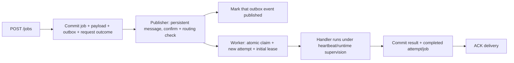

# Messaging and Safe Execution — Phases 4–5

Phase 4 connected the API/outbox to RabbitMQ and introduced safe ECHO execution.
Phase 5 now executes SIMULATED_WORK, renews leases, enforces runtime limits, and
implements automatic/manual retry and recovery. See [reliability.md](reliability.md)
for those transitions, tests, and limits. At-least-once is not exactly-once or HA.

## Run

Use **Run platform (Java 21, macOS)** from VS Code's task menu. It starts both
Compose services, selects Java 21, sets `MESSAGING_ENABLED=true`, and launches
the application. Or, from a Java-21 shell:

```sh
docker compose up -d --wait postgres rabbitmq
MESSAGING_ENABLED=true mvn spring-boot:run
```

The API is at http://localhost:8080; RabbitMQ management is at
http://localhost:15672. Broker credentials default to the explicitly local-only
`job_platform` / `local-rabbit-development-only` values; override them outside
development. Both AMQP/management ports are bound to localhost. PostgreSQL and
RabbitMQ each have a named volume; do not delete volumes to restart services.
The broker has a stable hostname so ordinary container recreation reuses its data.

**Run API only (Java 21, macOS)** sets messaging off and needs only PostgreSQL.
Plain application startup defaults to messaging off, so enabling consumers is
deliberate and existing storage/API tests remain independent of a live broker.
Starting the full platform processes previously accepted queued jobs too,
including simulation events deferred during Phase 4, not just new submissions.

## One job's path



The worker may finish before the publisher records its successful publish. These
are separate database/broker operations, not one distributed transaction.

1. **Publish:** poll up to 100 unpublished eligible events, oldest first. Send
   only `{ "jobId": "<uuid>" }` to durable `jobs.exchange` / `jobs.queue`, using
   routing key `jobs.execute`, persistent delivery, mandatory routing, and
   correlated publisher confirms. The message ID identifies the outbox event;
   each send has a distinct correlation token.
2. **Record publication:** update only the corresponding outbox event after a
   positive confirmation with no returned-message routing error. Nacks, returns,
   timeout, missing exchange, or a database marking failure leave the row
   eligible. Failures stop that batch and the next scheduled poll retries it.
3. **Claim:** lock the job row, recheck `QUEUED`, and atomically commit `RUNNING`,
   both incremented counters, a new attempt ID/record, common database start
   time, and a database-derived 30-second lease. No handler runs inside that
   transaction. Duplicate current/terminal deliveries do not create attempts.
4. **Complete:** after a handler produces its result, lock again and require current
   `RUNNING` attempt plus an unexpired lease using fresh `clock_timestamp()`.
  Also reject success beyond the attempt runtime deadline. Commit job completion, JSONB result, attempt completion/end, and cleared lease
   together. Any related write failure rolls back the whole transition.
5. **Acknowledge:** only after the outcome transaction returns successfully,
   ACK on the original delivery's channel. A confirmed stale/duplicate delivery
   is also ACKed without writing as an old owner.

### Duplicates are expected, not a publisher bug

A broker send can succeed before the database publication mark fails. The event
will be sent again. Neither a SQL transaction around the send nor publisher
confirms make PostgreSQL and RabbitMQ atomic together. Duplicate notifications
are handled by the job's atomic claim and current-attempt checks; external
side-effect idempotency is still a separate requirement.

## Bounded intake, failure handling, and lifecycle

- Ten synchronous consumers with prefetch one each give ten outstanding
  deliveries/handler slots across this worker. There is no unbounded local
  handler queue. ECHO returns promptly; SIMULATED_WORK uses cancellable waits.
  Independent supervision and reserved database connections protect lease/runtime checks.
- Invalid JSON/UUID notifications are logged/metered and rejected without
  requeue. Authoritatively confirmed missing jobs are treated the same way.
  Without a V1 dead-letter queue, those rejected notifications are discarded.
- A genuinely unsupported type arriving for a known queued job gets a claimed
  attempt and ownership-checked permanent failure before ACK. Supported simulation
  is executed and its configured failures use the platform retry budget.
- A database failure/unknown outcome is not an ACK. Pause worker intake,
  asynchronously stop its container (never blocking a consumer on its own
  shutdown), then restart with increasing backoff capped at 30 seconds. Channel
  closure makes unacknowledged deliveries available for redelivery. Already
  committed work is recognized; no blind rerun of the same active attempt.
- A worker-backoff executor is separate from the outbox poll scheduler.
  Application shutdown marks workers closing and prevents delayed restart.
- Unresolved ownership/commit outcomes also pause intake with backoff. Channels
  close so unacknowledged messages return to the broker; lease recovery owns
  further progress for abandoned claimed attempts.
- Overall health includes RabbitMQ when messaging is enabled. HTTP readiness
  still represents the API's ability to accept durable database/outbox work;
  it does not claim queue progress while the broker or worker is unavailable.

## Current Execution and Durability Limits

- Both accepted job types are now published/executed. Every automatic cycle has
  four attempts; retry scheduling/heartbeat/recovery follow [reliability.md](reliability.md).
- Cancellation is cooperative. A database token or broker timeout cannot
  force-stop arbitrary old Java code or undo an external action. Ten execution
  slots remain occupied until their handlers actually exit.
- RabbitMQ's `consumer_timeout = 600000` is ten minutes from delivery, separate
  from database leases. It is configured in [docker/rabbitmq.conf](../docker/rabbitmq.conf).
  We verified the effective setting on RabbitMQ 4.1.8. Enforcement is periodic;
  timeout can close a channel/requeue unacknowledged deliveries, not revoke a
  database attempt or authorize a stale completion.
- Persistent single-node volumes cover ordinary restarts with saved data intact,
  not permanent data loss, high availability, or exactly-once execution.
- No schema migration beyond V2 was needed for this phase. Application concurrency
  updates are explicit SQL; ORM entities remain read mappings without unsafe
  generic execution-state setters.

## Settings

| Setting | Initial value |
| --- | --- |
| `MESSAGING_ENABLED` | `false` on plain startup; full-platform task sets `true` |
| `PUBLISHER_ENABLED` / `WORKER_ENABLED` | `true` when messaging is enabled |
| `RABBITMQ_HOST` / `RABBITMQ_PORT` | `localhost` / `5672` |
| `RABBITMQ_USERNAME` / `RABBITMQ_PASSWORD` | Local development defaults above |
| `RABBITMQ_MANAGEMENT_PORT` | `15672` (Compose host mapping) |
| `platform.messaging.publisher-delay-ms` | `1000` |
| `platform.messaging.batch-size` | `100` |
| `platform.messaging.confirm-timeout-ms` | `5000` |
| `platform.messaging.worker-concurrency` | `10`; per-consumer prefetch is `1` |
| `platform.messaging.lease-seconds` | `30`; renew every 10 seconds while owned |

Reliability settings, including the five-minute runtime and bounded polling,
are listed in [reliability.md](reliability.md). Supervision uses its own four-thread
scheduler and four-connection pool; main polling uses three scheduling threads.

The publisher and worker flags allow isolated tests/debugging. Disabling a worker
can accumulate queued messages; disabling a publisher leaves outbox work pending.
Spring Boot launched by Maven still does not automatically load a root .env file.

## Validation

`mvn verify` uses real disposable PostgreSQL 17.6 and RabbitMQ 4.1.8 containers
for messaging tests, alongside listener/lifecycle unit tests and earlier API/
persistence regressions. Tests cover positive/negative/unknown confirms, routing
returns, missing exchange, mark-after-send failure, durable topology/persistent
delivery, simultaneous claims, strict expiry, stale ownership, atomic rollback,
completion-before-ACK followed by actual channel-close redelivery, malformed/
missing notifications, worker resource bounds, and shutdown/backoff behavior.

Fault-injection DDL and controlled recovery-state fixtures run only in disposable
test databases, not the persistent local development database. Phase 5 adds the
actual worker-JVM crash recovery and supervision tests described in
[reliability.md](reliability.md); sustainable throughput remains unmeasured.