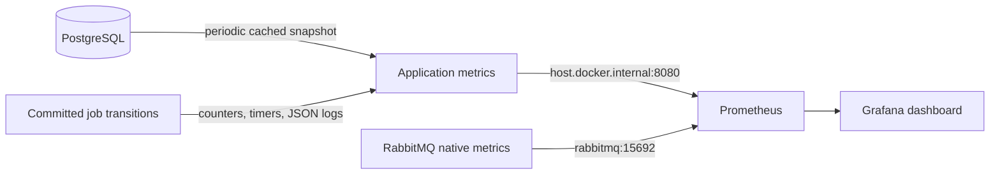

# Observability — Phase 6

The platform now explains what it is doing through JSON logs, metrics, and a
local dashboard. PostgreSQL still decides job state; monitoring never decides
whether a worker may write or acknowledge a message.

## Open the visual view

Use **Terminal → Run Task → Start monitoring (Prometheus and Grafana)** with
Docker Desktop running, then **Run platform (Java 21, macOS)** if the app is not
already running. Do not start a second app on port 8080.

- [Execution and Reliability dashboard](http://localhost:3000/d/job-platform-overview)
- [Prometheus scrape targets](http://localhost:9090/targets)
- [Application metrics](http://localhost:8080/actuator/prometheus)
- [Application health](http://localhost:8080/actuator/health)

Grafana local username: **job_platform**. Initial local-only password:
**local-grafana-development-only**. These are deliberately development defaults,
not production credentials. Set `GRAFANA_USERNAME` / `GRAFANA_PASSWORD` before
initializing a new volume to change them; changing Compose variables does not
reset an existing Grafana account. Anonymous access and sign-up are disabled.

The optional `monitoring` Compose profile adds pinned Prometheus **v3.6.0** and
Grafana **12.2.0**, with persistent named volumes. Host ports 9090 and 3000 bind
only to localhost. **Stop monitoring (preserve data)** stops those services
without deleting job data or monitoring history. Prometheus keeps seven days of
samples; that retention does not delete jobs, payloads, attempts, or outbox rows.

RabbitMQ's native `rabbitmq_prometheus` plugin serves port 15692 only on the
Compose network; no new exporter or application broker-admin credentials are
needed. Recreating the broker to apply its plugin mount preserves its named
volume. Application metrics remain available without starting Grafana/Prometheus.

## How the data reaches the dashboard

Prometheus scrapes every five seconds. It reaches the host application through
`host.docker.internal`, **not** container-local `localhost:8080`. The host gateway
mapping is included for Docker hosts that need it. If `SERVER_PORT` changes,
update the application target in [the scrape configuration](../docker/prometheus/prometheus.yml).
No automatic service discovery or multi-host deployment is claimed.

Only Actuator health and Prometheus endpoints are exposed. Health details remain
hidden; environment/configuration/bean endpoints are not exposed. The application
API/metrics do not add authentication in this milestone: keep the app on a trusted
development machine/network, and do not publicly expose these services.

## Reading the dashboard

The [provisioned dashboard](../docker/grafana/dashboards/job-platform.json) has
16 panels, with worker state, health/freshness, database job status, broker
ready/unacknowledged messages, throughput, retries/failures, latency, backlog,
connection pools, heartbeat renewals, and JVM memory. Grafana updates every five
seconds; historical panels may require scrolling into view.

Start with these questions:

1. **Are both scrape targets UP?** A missing sample is not a zero backlog.
2. **Is the database snapshot healthy and recent?** Check up=1 and age near the
   ten-second refresh interval. An old snapshot can still show plausible counts.
3. **Where is work waiting?** Unpublished outbox rows mean notifications still
   need publication; broker-ready messages are waiting for delivery; unacknowledged
   messages include executing work. They are different stages, not additive totals.
4. **Are workers progressing?** Compare active handlers, capacity, consumers,
   paused intake, heartbeats, and terminal outcomes. Active=0 is normal when idle.
5. **Are retries helping?** A failed attempt need not mean a failed job; distinguish
   attempt failures from exhausted/permanent terminal job failures.

Rate graphs need at least two samples. Counters are registered when their events
first occur: **No data** can mean no such event has occurred since startup. It
does not prove a zero error rate, especially when the scrape target is DOWN.
Short demo events eventually leave a sliding rate window. Select their historical
time range to revisit them. Sparse percentile graphs can be NaN when no requests
or attempts completed in that interval; no baseline result is implied.

### Concrete example

A `SIMULATED_WORK` job with `durationMillis=1000` and `failFirstAttempts=2`
produces this sequence in an otherwise healthy platform:

| Observation | Change |
| --- | --- |
| New submission commits | Accepted jobs +1 |
| First attempt fails | Attempts started +1; failed attempts +1; job RETRYING |
| Due retry is queued | Automatic retries +1; new outbox event |
| Second attempt fails | Same failure/retry sequence |
| Third attempt succeeds | Completed attempts +1; terminal COMPLETED jobs +1 |
| Original request is replayed | API replay response +1; accepted jobs unchanged |

That is **one accepted job, three attempts, two automatic retries, and one
successful terminal job**, not three accepted jobs. Structured log `jobId`
connects these events; each `attemptId` identifies one execution.

## Metric contract

Micrometer names below are shown in application form. Prometheus changes dots to
underscores, adds `_total` to counters and `_seconds` to timer/seconds families.
For example, `jobs.accepted` becomes `jobs_accepted_total`.

| Metric | Meaning / labels |
| --- | --- |
| `jobs.accepted` | Newly committed jobs, `type=ECHO/SIMULATED_WORK/OTHER`; no replay or manual-cycle increment |
| `jobs.attempts.started` | Committed execution claims, bounded `type` |
| `jobs.attempt.outcomes` | Committed attempt terminal records, `outcome=COMPLETED/FAILED/EXPIRED/OTHER`, bounded `failure` |
| `jobs.terminal` | Committed terminal job outcomes, `outcome=COMPLETED/FAILED`; one job can reach FAILED again in another manual cycle |
| `jobs.retry.events` | Committed new retry/outbox transitions, `kind=automatic/manual`; not every retry check |
| `jobs.heartbeat.renewed` | Committed lease renewals, no job/attempt labels |
| `jobs.api.outcomes` | Returned saved-request flows by logical `operation`, `replay`, HTTP `status`; not every HTTP error |
| `jobs.first.start.delay` | Job creation to first-ever attempt claim, bounded `type`; approximate acceptance-to-start timing |
| `jobs.attempt.duration` | Stored attempt start to recorded terminal outcome, bounded `outcome` |
| `jobs.worker.active` | Local claimed handlers occupying slots until actual exit, including finalization/cancellation |
| `jobs.worker.capacity/consumers/running/paused` | Configured local slots, active consumers, listener running flag, infrastructure-backoff flag; messaging mode only |
| `jobs.state{status}` | Cached database job counts by fixed status |
| `jobs.outbox.pending/oldest.age` | Cached unpublished row count / oldest pending age in seconds; age zero when none |
| `jobs.retry.due/leases.expired` | Cached due-retry count / expired-running-lease count |
| `jobs.snapshot.up/last.success/failures` | Latest refresh success flag / Unix timestamp in seconds / failure counter |
| `jobs.outbox.confirmed/failures` | Existing successful confirm-and-record observations / publication failures, not unique-job counts |
| `jobs.messages.acknowledged/invalid/missing/unresolved` | Existing delivery observations; duplicates and discarded invalid references are not new jobs |
| `jobs.retries.queued/attempts.expired` | Existing poller observations; overlap with lifecycle retry/EXPIRED metrics, do not add them together |
| `http.server.requests` | Spring's server-observed HTTP requests/duration, templated URI, method/status; includes errors |
| `hikaricp.*`, `jvm.*`, `process.*` | Pool and runtime metrics, including dedicated `pool=attempt-control` |
| `rabbitmq_queue_messages_ready/unacked` | Native aggregate broker queue counts in this single-broker, one-job-queue deployment |

Failure labels are only `NONE`, `TIMEOUT`, `LEASE_EXPIRED`, `SIMULATED_FAILURE`,
`INVALID_PAYLOAD`, `MISSING_PAYLOAD`, `UNSUPPORTED_JOB_TYPE`, or `OTHER`.
API operations are `SUBMIT_JOB`, `SUBMIT_BATCH`, `RETRY_JOB`, or `OTHER`;
the UUID suffix of a retry scope is never a metric label. IDs, request keys,
payloads, failure reasons, and exception messages are not metric labels.

### Timing is explicit, not a new SLO claim

- First-start timing uses immutable job creation and first-attempt timestamps from
  PostgreSQL. It includes time inside the acceptance transaction **before commit**;
  it is not the exact durable-commit-to-start measure required for a benchmark.
  Automatic/manual later attempts do not record another first-start sample.
- Attempt duration includes persistence and, for EXPIRED attempts, delayed recovery
  detection. It is not pure handler CPU time. Creation/start and attempt durations
  use database timestamps, not clocks compared between containers.
- HTTP duration is observed by the server, not the client's network round trip.
- Histograms export buckets for aggregation/p95/p99. The configured maximum finite
  range is one hour for first-start and ten minutes for attempt duration; values
  beyond it still enter count/sum/+Inf, but tail estimates beyond the finite range
  are not trustworthy. Percentiles with very few samples are not benchmark evidence.

## Commit safety and monitoring limits

Lifecycle observations register in the transaction that changes the data and emit
only in `afterCommit`, including transactions from the independent supervision
pool. Outcome timestamps use `UPDATE ... RETURNING` on the existing write: no extra
telemetry-only SQL query is added to the transition. Exporter observation errors
are caught and cannot reverse a committed job or change the worker ACK decision.
Metrics/logs never renew a lease or claim work.

Counters/logs are **best-effort, process-local observations**, not a durable audit
ledger. They reset when the process restarts. A process can die after commit but
before observation; an unknown commit result can also leave observation gaps.
Database state and saved attempt history remain authoritative.

The database snapshot runs on its own one-thread scheduler every ten seconds,
with a two-second statement timeout and the primary pool's connection-acquisition
limit. Scrape callbacks read cached scalars only; they never query PostgreSQL.
Initial values are NaN/unknown with up=0. A failed refresh keeps the last good
values, sets up=0, increments failures and preserves last-success time. Its status
count query scans retained data and is **not constant-cost or limited to the
pollers' 100 candidates**. Revisit sampling frequency/query cost before sustained
load; the reserved heartbeat pool is not consumed by snapshot queries.

Database snapshots are global counts repeated by each app instance. If later
scraping multiple instances against one database, do **not** sum those gauges;
choose one instance or aggregate with `max` by status/system. Local worker gauges
can be summed; rate counters should use per-instance `rate` before aggregation.
The supplied dashboard targets the current single application deployment.

## Structured logs

Spring Boot's native ECS console format emits JSON. Committed lifecycle messages
carry stable `event` fields: `job_accepted`, `attempt_started`, `attempt_outcome`,
`retry_queued`, and `outbox_published`. Cancellation/uncertain supervision and
worker-backoff messages identify why intake or an attempt stopped.

Use `jobId`, `attemptId`, `outboxId`, `jobType`, status and bounded failure category
for correlation. Lifecycle logs do not contain payloads, idempotency keys, raw
failure reasons, or credentials. Infrastructure/library logs can still include
connection metadata; do not enable SQL parameter/HTTP body logging for secrets.
JSON logs stay in the application console: no central log store or distributed
trace system is added here.

## Validation performed

- Full Java 21 `mvn verify`: **170 tests**, no failures/errors/skips, executable JAR
  rebuilt. Includes 10 real-PostgreSQL/HTTP telemetry tests and 3 telemetry unit
  tests in addition to all 157 existing regression tests.
- Verified metrics/logs skip rolled-back acceptance/claims/outcomes, including
  control-pool rollback; replay does not accept another job/cycle; expiry/retry
  transitions count once; second attempts do not change first-start sample count.
- Verified initial unknown snapshot values, cached no-query gauge reads, refresh
  failure with retained last-good values, recovery and safe Prometheus scraping.
- Checked finite labels, JSON lifecycle IDs without payload/request keys,
  observation-failure isolation, Prometheus export/pool instrumentation and
  non-exposure of other Actuator endpoints.
- Compose configuration and `promtool check config` passed; both live targets
  reported UP, Grafana datasource health was OK, all **31** provisioned PromQL
  expressions parsed, and dashboard provisioning/browser display were verified.
- Four labelled retained demo jobs produced one ECHO success, a two-failure then
  third-attempt success, four-attempt exhaustion, and a 15-second successful
  simulation with a heartbeat renewal. Replay accepted no new jobs. Across that
  demo: accepted=4, attempts=9, automatic retries=5, completed jobs=3, failed jobs=1.
- Final application restart loaded the validated histogram configuration: health
  and both targets remained UP, ten consumers/zero active handlers, cached totals
  7 COMPLETED/2 FAILED. Counters reset normally; saved jobs and historical samples
  survived. Demo rates are historical; choose the demo time range to revisit them.

No new schema migration, cleanup, sustained benchmark, alert-routing service,
production authentication, multi-node HA, or exactly-once side effects are claimed.
Phase 7's later bounded load/failure measurements are now recorded in
[the performance guide](performance.md) and [measured report](benchmarks/2026-10-25.md).
They do not turn these telemetry observations into capacity or availability guarantees.