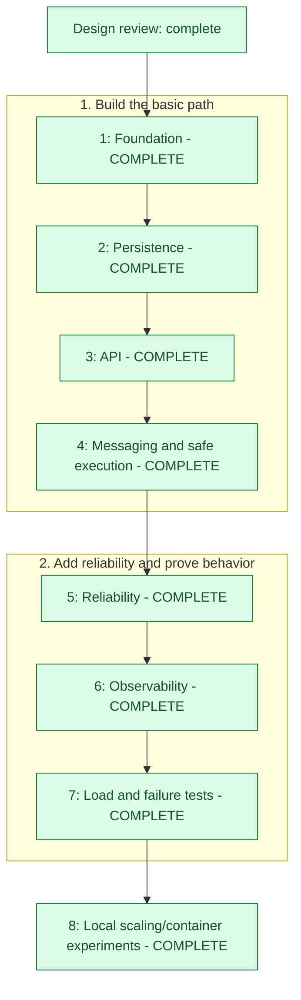

# Project Progress

This is a manual progress tracker, updated as work is completed. Checked items mean completed work, not planned functionality.

## Current status

**Stage: Phase 8 local scaling/container experiments complete and validated. Kubernetes/HA remain deferred.**

**Review progress: 6/6 steps complete; 9/9 findings resolved. Implementation: 8/8 local milestones complete under the scope recorded below.**

**Implementation milestones:** ■ ■ ■ ■ ■ ■ ■ ■ — **8/8 local milestones complete**

These boxes count completed phases, not percentage of effort or time. Phases differ in size.
They do not count deferred Kubernetes, multi-host HA, long soaks or unmeasured target guarantees as implemented.

## Visual Roadmap

Build a platform that accepts jobs, stores them safely, sends execution notifications through RabbitMQ, and lets workers process them with retries and crash recovery. Start locally with `ECHO` and `SIMULATED_WORK`; measure the system before exploring larger deployments.

**Legend:** green = complete; blue = active/next as labelled; gray = planned. Completed phases differ in size and do not mean a time/effort percentage. Open Markdown Preview for Mermaid rendering where supported.

## Active Work

| Item | Current value |
| --- | --- |
| Current activity | Public repository published with verified main commit and first hosted CI pass; implementation learning remains in progress |
| Next milestone | Maintain supported pinned CI actions and resume-friendly presentation, then continue the implementation walkthrough |
| Latest validation | 2026-10-26: 173 Java + 79 Python tests passed; public guard passed for 109 staged files; both Compose definitions validated |
| Blockers | No publication blocker; local scope/measurements and hosted checks do not establish Kubernetes/HA or every target |

### Public Repository Preparation — 2026-10-26

- [x] Separate this project's Git root from the enclosing, unaudited parent repository.
- [x] Prepare recruiter-facing README and retain detailed local setup in a separate guide.
- [x] Add least-privilege GitHub Actions checks, security/contribution guidance, ignore rules and eight tested public-file guard checks.
- [x] Configure the user-approved public author identity locally only; GitHub no-reply email avoids publishing personal email.
- [x] Verify 173 Java/79 Python tests, staged public paths, documentation links and Compose syntax locally.
- [x] Publish to the requested GitHub account after direct authentication; no force-push or existing history overwritten.
- [x] Verify public visibility, all 109 intended files, matching initial main commit `1b941e6`, and the first hosted CI result.

Public repository: [sahilnain11/distributed-job-platform](https://github.com/sahilnain11/distributed-job-platform).
[First hosted verification](https://github.com/sahilnain11/distributed-job-platform/actions/runs/40377713810)
passed on 2026-10-26, including public-file checks, Python/Java suites, Compose
validation and actual disposable two-worker container execution. Build output,
private environment files and raw logs are excluded. Actions are updated to
supported SHA-pinned versions after the first run reported deprecation warnings.

No license was added: the owner selected **no license yet**. Public visibility
does not grant reuse rights. Example passwords remain explicitly local/disposable;
no obvious actual credentials were identified in the focused audit. These checks
are not a complete security certification.

### Implementation Understanding — separate from feature completion

- [x] Inspect current acceptance, persistence, messaging/reliability, telemetry and deployment/tooling code.
- [x] Prepare [a complete code-linked teaching guide](implementation-review.md) with diagrams, SQL, examples, rationale and limits.
- [x] Create [an interactive visual explorer](implementation-explorer.html) for illustrative job/failure traces; no real data mutations.
- [x] Check all six visual scenarios, cumulative states/counters, previous/next/reset/timeline controls, chapter navigation, mobile layout and local source links; no page JavaScript errors in those checks.
- [ ] Discuss the architecture, one-job path and each failure/concurrency checkpoint with the project owner.
- [ ] Confirm understanding using the guide's explain-it-back checklist; no assumption that document creation completes learning.

### Phase 8 Task Checklist

- [x] Inspect the existing generator, worker configuration and resource limits.
- [x] Add isolated role-separated API/publisher and configurable worker processes with safe cleanup.
- [x] Compare one/two workers and equal aggregate slots under identical offered workloads.
- [x] Attempt high-rate publisher case, retain dropped-arrival invalid results, then measure low-load ECHO publication-wait tuning.
- [x] Verify results/ownership, connection budgets, regression tests and retained charts/methodology.
- [x] Record completed local scope and explicitly defer Kubernetes/HA and unmeasured targets.

### Phase 8 Validation Evidence — 2026-10-25

| Check | Actual result |
| --- | --- |
| Regression/tools | Java 21 full verify: 173 tests, 0 failures/errors/skips; 71 Python tests including role separation, cohort checks, metric parsing, cleanup and container orchestration |
| Isolation/layout | One API/publisher/recovery JVM plus worker JVMs, fresh dependencies per scenario; no development traffic/data/faults; publisher count and dependency limits held fixed |
| One worker | 1×10 slots at 15/s, 900 accepted: 9.52 completed/s, 327 unfinished, first-start p95 APPROX 31.26s, sampled DB connections 24 |
| Two workers | 2×10 at same 15/s, 900 accepted: 14.59 completed/s, 21 unfinished, first-start p95 APPROX 1.03s, sampled connections 38; job split 448/452 |
| Equal-slot control | 1×20 at same 15/s: 14.68 completed/s, 15 unfinished, sampled connections 24; client p99 358.20ms, so no universal latency improvement claim |
| Scaled overload | 2×10 at 25/s, 1500 accepted: 17.81 completed/s, 427 unfinished, client p99 782.07ms, sampled pending pool requests up to 3; drained later |
| Polling comparison | ECHO 15/s/2×10, fixed delay 1000→100ms experiment-only: creation-to-start p95 APPROX 1.415→0.120s; defaults unchanged, more polls not free |
| Correctness | Six selected valid cases: all 6,000 measured jobs eventually completed correctly with one attempt, unique mapped IDs, all workers participating, no dropped arrivals/HTTP errors/unknown commits |
| Costs | 2 JVMs vs 3: heap max 1024 vs 1536MiB, configured DB budget 28 vs 42; actual sampled connections 24 vs 38. Added JVMs do not hold total resources constant |
| Invalid attempts | First scaled overload observation timed out, excluded. High ECHO offers dropped 73 (150/s), 964 (150/s larger generator), 123 (60/s) arrivals; retained as invalid rather than success-only throughput |
| Container packaging | Verified digest-pinned Java21 image; numeric non-root 10001:10001; independent Compose API/publisher+scalable workers, localhost8081, no host worker/DB/broker ports, read-only app roots, 1CPU/512MiB each |
| Container execution | Unique disposable Compose smoke: 20 simulation jobs, 20 attempts/results, 2 worker IDs, 3 app containers; correct results/security/resource limits verified; removed only smoke project |
| Final boundaries | Development health/monitoring and original jobs preserved; experiments cleaned; no production execution/default/schema changes. Kubernetes, multi-host HA, autoscaling/long-soak/max-capacity/exact SLO work remains deferred |

Open [the scaling measurements/chart](benchmarks/2026-10-25-scaling.md),
[machine-readable evidence](benchmarks/2026-10-25-scaling-summary.json), and
[local experiment/deployment guide](scaling.md). Phase 8 completion refers to this
explicit **local** scope, not deferred infrastructure exploration or a production-ready guarantee.

### Phase 7 Task Checklist

- [x] Inspect the measurement contract, execution defaults, and existing failure coverage.
- [x] Add bounded open-loop load generation, explicit measurement boundaries, and reproducible reports.
- [x] Run fixed-payload ECHO and one-second no-failure simulation baselines plus a labelled overload run.
- [x] Test real broker/database outages and restoration using disposable dependencies only.
- [x] Run full regressions, review actual targets/bottlenecks, and document evidence and limitations.

### Phase 7 Validation Evidence — 2026-10-25

| Check | Actual result |
| --- | --- |
| Regression | Java 21 `mvn verify`: 173 tests, 0 failures/errors/skips, JAR rebuilt; 10 Python measurement/cleanup tests passed |
| Isolation | New random-port PostgreSQL/RabbitMQ containers and a separate loopback application; development services were never faulted/submitted to; disposable cleanup verified |
| Generator | Fixed arrival rate, 16 request threads/32 outstanding maximum, dispatch deadlines/drop accounting, separate observer thread, unique keys/warm-up exclusion, raw request/history/resource evidence |
| Baseline ECHO | Final run: 50 offered/s for 60s, 3,000 accepted; 2,971 completed in actual 60.158383s DB window = 49.39/s; client p99 22.07ms; 29 unfinished, observed drain 0.37s |
| Baseline simulation | One-second/failures=0, 5 offered/s for 60s, 300 accepted; 292 completed in 60.109579s = 4.86/s; client p99 55.50ms; 8 unfinished, observed drain 2.33s |
| Labelled overload | Same simulation, 15 offered/s for 60s, 900 accepted; 574 completed in 60.115453s = 9.55/s; client p99 144.48ms but 326 unfinished, observed drain 34.90s; approximate first-start p95 31.58s |
| Correctness/errors | All 4,200 measured final-run jobs eventually COMPLETED, one attempt and correct result each; no HTTP errors, generator drops, unknown commits or missing arrivals; 200 warm-up jobs excluded |
| Repeat | Earlier full qualification suite showed the same bottleneck: overloaded completion 9.48/s, 331 unfinished, 36.71s drain; observer changes mean not a controlled performance-improvement comparison |
| Actual broker outage | Fresh AMQP connection failed; API accepted/replayed 202 with unpublished outbox; earlier durable queued work and new work completed once after automatic reconnect |
| Actual database outage | POST/GET/readiness returned 503; no falsely accepted rows/key; same-key retry after restoration committed once; original cluster/data/container/port preserved |
| In-flight outage | Prior renewal observed; DB loss caused supervision cancellation/paused intake; real lease expiry then EXPIRED→COMPLETED after restore, one result, stale writes rejected |
| Existing fault coverage | Separate worker JVM force-kill/recovery, duplicate resend/redelivery, timeout cancellation, rollback and primary-pool starvation tests remained passing |
| Bottleneck | Ten one-second slots saturated under 15/s; broker-ready backlog rose. ECHO sampled waiting mostly in outbox, consistent with one-second publication polling, not measured maximum capacity |
| Scope | No production code/schema/default change, no job cleanup outside disposable fixtures; final development health UP and original 7 COMPLETED/2 FAILED jobs unchanged |
| Limits | One-minute local windows, shared host, approximate creation-to-start timing; no 1,000/s offer, maximum-throughput sweep, long soak, permanent-loss/partition guarantee, scaling or 99.9% proof |

Read [the retained measured report and backlog chart](benchmarks/2026-10-25.md),
[machine-readable summary](benchmarks/2026-10-25-summary.json), and
[repeatable methodology](performance.md). Raw build-output artifacts remain available
locally but are not the only retained evidence.

### Phase 6 Task Checklist

- [x] Inspect existing metrics, transaction boundaries, and deployment/test setup.
- [x] Add safe after-commit counters/timers, structured logs, local worker visibility, and periodic database snapshots.
- [x] Add Prometheus export and RabbitMQ metrics without querying databases during scrape.
- [x] Provision persistent local-only Prometheus/Grafana services and a useful dashboard.
- [x] Test rollback-safe telemetry, bounded tags, snapshots, scrapes, logs, and existing reliability behavior.
- [x] Validate live scrape targets/dashboard data and record evidence.

### Phase 6 Validation Evidence — completed 2026-10-25

| Check | Actual result |
| --- | --- |
| Final build | Java 21 `mvn verify`: 170 tests, 0 failures/errors/skips; executable JAR rebuilt; schema remains V2 |
| Added tests | 10 real PostgreSQL/HTTP observability tests, 3 telemetry unit tests; all 157 existing tests still passing |
| Commit boundaries | Rolled-back acceptance/claim/outcome/retry writes emit no successful lifecycle observations; independent supervision transaction rollback also tested |
| Metric meaning | New submissions/replays/manual cycles distinguished; committed expiry/retry count once; first-start sample only for lifetime attempt one; failure/type/operation labels finite |
| Safety/privacy | Exporter failures do not escape observation callbacks; JSON lifecycle logs include IDs but not request keys/payload values; IDs are not metric labels |
| Snapshot | Initial unknown/NaN and up=0; refresh caches state counts; failure retains last-good values with up=0/unchanged success time; gauge reads and scrapes do not query the database |
| Timing/exposure | Prometheus export and five-minute-capable histogram ranges checked; only health/Prometheus exposed, other Actuator endpoints 404; both primary and reserved pools instrumented |
| Infrastructure | Pinned Prometheus v3.6.0/Grafana 12.2.0; optional monitoring profile, localhost bindings, named volumes, native internal RabbitMQ metrics; Compose/promtool validation passed |
| Live scrape/dashboard | Application and RabbitMQ targets UP; datasource health OK; 16 panels provisioned; all 31 PromQL expressions valid; browser showed live health/freshness/worker data |
| Retained demo | Key `phase6-observability-demo-88eacaae-9c64-4fa0-8001-01792ffaee2f`: four jobs, accepted once then matching replay; one ECHO success, third-attempt simulation success, four-attempt exhaustion, and 15-second successful simulation with renewal |
| Demo counters | In the observing process: accepted=4, attempts=9, failed attempts=6, automatic retries=5, terminal completed=3/failed=1, heartbeat renewal=1; histories retained |
| Final restart | Reloaded final histogram configuration; health and both targets UP, ten consumers, zero active handlers; cached database total 7 COMPLETED/2 FAILED. Process-local counters reset as documented, while database/history and Prometheus samples survived |
| Honest limits | Process-local counters reset and can miss post-commit crashes; first-start timer includes precommit time; HTTP timer is server-side; snapshots scan retained data and can stale; no sustained benchmark or SLO/HA proof |

See [observability.md](observability.md) for local dashboard access, a concrete retry example, metric names/units, and limits. No automatic job cleanup or new schema migration was added.

### Phase 5 Task Checklist

- [x] Inspect retry, ownership, timeout, idempotency, and current worker contracts.
- [x] Add atomic retry/failure/recovery/heartbeat transitions and bounded schedulers.
- [x] Add independent runtime supervision and cancellable per-cycle simulation.
- [x] Add scoped manual retry endpoint with frozen replay and fresh cycle budgets.
- [x] Test budget/backoff, concurrent retry/recovery races, long-job leases, timeout, crashes, and stale outcomes.
- [x] Run full regression/live smoke checks and document verified limits.

### Phase 5 Validation Evidence — 2026-10-22

| Check | Actual result |
| --- | --- |
| Final build/tests | Java 21 `mvn verify`: 157 tests, 0 failures/errors/skips; executable JAR rebuilt; schema remains V2 |
| Added groups | 10 manual retry HTTP/PostgreSQL tests, 12 retry/supervision SQL tests, 6 active reliability broker tests, 2 supervisor lifecycle/uncertainty tests; earlier 127 tests adapted for enabled simulation/manual API and still passing |
| Retry budget | Default 1/2/4-second due-time bounds checked; fourth retryable failure or expiry ends cycle; counters advance only on committed claims |
| Atomic polling | Competing retry schedulers/recovery managers transition once; outbox/attempt-write faults roll back associated job transitions |
| Simulation | Per-cycle configured failures, successful result, permanently invalid stored settings, and activation of previously deferred events tested |
| Manual retry | Fresh four-attempt budget, retained creation/history, reset job timestamps, same-key frozen replay before eligibility, target-specific scope, changed-key-input conflict, different-key race 202/409, same-key race 202/replay, and rollback on event failure |
| Heartbeat/resources | Real job completes beyond its initial two-second test lease with one attempt; supervision succeeds with all ten primary connections occupied; independent four-thread/four-connection controls |
| Timeout | Watchdog actually interrupts cooperative waiting; retry/exhaustion without result; late-success persistence independently rejects runtime expiry even if a watchdog was delayed |
| Actual crash | Disposable test launches a separate worker JVM, kills it after committed claim, and verifies surviving platform records EXPIRED then replacement COMPLETED; no user process/production storage touched |
| Stale ownership | Recovered/superseded worker cannot complete or renew another attempt; runtime/control checks use the original attempt start and fresh database time after locking |
| Cancellation/uncertainty | Database supervision error requests cancellation and refuses an uncertain outcome write; shutdown registration failure leaves no active watch; infrastructure redelivery/recovery preserves at-least-once behavior |
| Live normal-default retry | Key `phase5-retry-smoke-20261022`, job `1007fb74-8473-421e-bf04-be344e1a747a`: FAILED, FAILED, COMPLETED history, three attempts/events |
| Live manual history | Key `phase5-exhaustion-smoke-20261022`, job `a696f08a-6ab7-4642-ad54-4c76bb77b565`: exhausted attempts 1–4; manual key `phase5-manual-smoke-20261022` ran attempts 5–8 and failed again as configured; replay of old key returned original 202 without restart |
| Live eligibility/health | New retry of completed work returned 409/JOB_NOT_FAILED; health `UP`; no incomplete saved-request reservations; demo/history records retained |
| Boundaries | Production defaults remain 30-second lease/10-second renewal/five-minute runtime/1-2-4-second backoff; timing tests shorten isolated settings or adjust disposable timestamps. No full five-minute soak, load benchmark, permanent storage-loss recovery, or exactly-once external action claimed |

Current guide: [reliability.md](reliability.md). API attempt history is now available; control transactions use a separate small connection pool so ordinary primary-pool use cannot consume renewal resources. Cancellation does not release an execution slot until the handler exits, and broker timeouts cannot force-stop Java code. Subsequent local experiment/scaling evidence is recorded above.

### Phase 4 Task Checklist

- [x] Inspect the approved messaging, lease, and ACK contracts.
- [x] Add durable RabbitMQ topology, persistent local storage, and opt-in messaging configuration.
- [x] Add confirmed mandatory outbox publishing and transactional SQL claim/outcome persistence.
- [x] Add bounded manual-ACK workers and safe invalid/stale/error delivery handling.
- [x] Verify end-to-end execution, duplicate races, stale writes, publisher failures, and ACK ordering.
- [x] Run local smoke checks and record actual evidence without claiming Phase 5 recovery.

### Phase 4 Validation Evidence — 2026-10-21

| Check | Actual result |
| --- | --- |
| Build/tests | Java 21 `mvn verify`: 127 tests, 0 failures/errors/skips; JAR rebuilt |
| New test groups | 10 SQL execution tests, 11 listener tests, 10 real RabbitMQ integration tests, 3 lifecycle/backoff tests; earlier 93 tests remain passing |
| Dependencies | Spring AMQP 3.2.12; RabbitMQ 4.1.8 management image verified; PostgreSQL 17.6 unchanged |
| Publication | Persistent messages, durable exchange/queue, positive confirms plus mandatory routing checks; unroutable returns, missing exchange, nacks/timeouts leave events eligible |
| Duplicate publish window | Injected mark-after-send database failure/resend produces duplicates but one execution/result; broker/DB operations are intentionally not one transaction |
| Ownership/transactions | Atomic claim + attempt/counters/start/initial lease; simultaneous claims produce one owner; expired/replaced attempts cannot write; result/attempt failures roll back job completion |
| Delivery behavior | Manual ACK follows committed outcomes; real unpooled channel close after completion-before-ACK triggers redelivery without another attempt; malformed/missing references rejected without requeue |
| Bounded intake/lifecycle | Ten consumers, prefetch one each; asynchronous stop/backoff and shutdown-no-restart tests pass; no unbounded local handler queue |
| Live topology | Compose PostgreSQL and persistent RabbitMQ healthy; effective broker `consumer_timeout` confirmed as 600000ms; queue observed with 10 consumers |
| Live ECHO | Key `phase4-echo-smoke-20261021`, job `f7ba09c2-946a-437a-8db2-6a8f8308fa87`: API acceptance replayed, completed with one attempt and JSON result equal to payload |
| Live duplicate | Deliberately injected duplicate for that completed job; queue ready/unacknowledged counts both zero afterward; attempt/result counts remain one |
| Previously queued work | Both Phase 3 demo ECHO jobs completed automatically when messaging was enabled; all demo/history rows retained |
| Phase boundary | ECHO only; simulation outbox events stay pending. No heartbeat renewal, automatic/manual retry execution, timeout cancellation, or recovery manager. A crash after claim may leave work waiting for Phase 5 |

Messaging is off on plain startup; **Run platform** explicitly enables it and starts both services, while **Run API only** leaves execution disabled. See [messaging.md](messaging.md) for flags, guarantees, deferred work, and expected duplicate behavior. No schema change beyond V2 or load benchmark was needed.

### Phase 3 Task Checklist

- [x] Inspect approved API, normalization, batch, and transaction rules.
- [x] Add submission/batch/retrieval and bounded status-filtered listing endpoints.
- [x] Add exact-number JSON parsing, canonical fingerprints, scoped saved outcomes, and database uniqueness-based request serialization.
- [x] Add real HTTP/PostgreSQL tests for validation, replay/conflicts, simultaneous requests, and rollback.
- [x] Validate the local application and update API documentation/evidence.

### Phase 3 Validation Evidence — 2026-10-21

| Check | Actual result |
| --- | --- |
| Final build | Java 21 `mvn verify` passed and executable JAR rebuilt |
| Tests | 93 total: 43 HTTP API/PostgreSQL, 9 fingerprint, 35 persistence, 5 foundation, 1 migration upgrade; 0 failures/errors/skips |
| Atomic acceptance | Stored job/payload/outbox and final request outcome together; induced storage errors roll back every row/reservation, including earlier batch items |
| Request concurrency | Matching requests return one saved job/outcome; changed racing input has one accepted winner and one 409; matching batches preserve all IDs/rejections |
| Replay and validation | Frozen original 202/400 responses, changed-input 409, malformed/duplicate/trailing JSON rejection, required key/type/payload checks, batch bounds and partial/all-invalid outcomes |
| JSON numbers | Exact decimal/large integer round trips and recursive normalization; meaningful value/type/array changes conflict; equivalent whole-number simulation settings validate consistently |
| Retrieval | Unknown/malformed ID errors, bounded status-filtered summaries, result reading, no old failure presented as a new-cycle/running/completed error |
| Live smoke test | Local 202 submit/replay with same ID, 409 changed input, 200 queued retrieval, mixed batch (1 accepted/1 rejected), listing and health `UP` |
| Demo records | Two intentional jobs remain queued from prefix `phase3-smoke-16fce38a-ff4e-4d11-82cb-05393dbf0719`; two finalized saved responses and two unpublished events, no incomplete reservations |
| Phase boundary | No RabbitMQ/publisher, handler execution, attempts/claims, scheduler/recovery, or manual-retry endpoint yet. No performance benchmark claimed |

The first test iteration caught raw JPA failures escaping the intended storage-error response. A later stronger check caught routing-time 415 responses bypassing controller-scoped advice. Both were fixed and all tests rerun successfully. Current retry-state failure display is covered; `RETRYING` can legitimately retain the failed attempt while waiting for automatic retry.

API contract and examples: [api.md](api.md). Errors/rollback fixtures run only against disposable PostgreSQL test containers. The two explicitly labelled live demo submissions remain in the local database under the agreed retention policy.

### Phase 2 Task Checklist

- [x] Inspect the approved schema, Phase 1 code, and available tools.
- [x] Add versioned tables, constraints, and indexes without changing applied V1.
- [x] Add JPA mappings/repositories and transactional job/payload/outbox persistence.
- [x] Verify JSONB round trips, constraints, rollback, and schema upgrade using real PostgreSQL.
- [x] Apply the new migration locally, verify health, and record evidence.

### Phase 2 Validation Evidence — 2026-10-21

| Check | Actual result |
| --- | --- |
| Build | `mvn --batch-mode --no-transfer-progress verify` passed under Java 21; executable JAR rebuilt |
| Tests | 41 total: 5 foundation, 35 persistence, and 1 migration-upgrade test; 0 failures/errors/skips |
| Test database | Disposable real PostgreSQL 17.6; test fixtures/constraint failures never run against the local development database |
| Schema/mappings | Six mapped tables: jobs, payloads, attempts, results, scoped request outcomes, and outbox; Hibernate validation passed |
| Data round trips | Nested JSONB, arrays, Unicode, large integers, timestamps, result/reference records, and scoped saved responses verified |
| Atomic writes | Outbox insert failure rolls back already flushed job/payload inserts; an outer request-outcome conflict rolls back all new work |
| Concurrency | Two simultaneous creates with the same job UUID commit exactly one job, payload, and outbox event; this is not HTTP idempotency replay |
| Constraints | Invalid states/counters, missing required attempt fields, orphan references, duplicate payload/result/attempt numbers, and two recorded running attempts rejected |
| Upgrade | V1 checksum/install time and unrelated data preserved in upgrade test; rerunning migrations applies nothing |
| Local smoke check | Existing named-volume database upgraded from V1 to V2 on application restart; all six tables/four planned indexes present; health/readiness `UP` |
| Phase boundary | `GET /jobs` is still HTTP 404; no API replay, publishing, handlers, claims, or retry execution implemented |

The persistence service is internal and not exposed over HTTP. A queued job stores its payload and an unpublished outbox event together; Phase 3 will wrap this with validation and the saved idempotency outcome in the same transaction. Later execution state changes still require explicit ownership-safe SQL rather than generic entity setters.

### Phase 1 Task Checklist

- [x] Check prerequisites and obtain Java 21 without changing global shell configuration.
- [x] Create Maven/Spring Boot application, JPA/Flyway configuration, and health endpoint.
- [x] Add PostgreSQL Compose service with persistent storage and local-only exposure.
- [x] Add real-PostgreSQL integration tests and local run documentation.
- [x] Build and run integration tests under Java 21.
- [x] Start Compose PostgreSQL and verify migrations, application startup, and HTTP health.
- [x] Record validation evidence and complete the milestone.

### Phase 1 Validation Evidence — 2026-10-20

| Check | Actual result |
| --- | --- |
| Runtime/build | Temurin Java 21.0.12.1; Maven 3.9.9; Spring Boot 3.5.16 |
| Compose configuration | `docker compose config --quiet` passed |
| Build and integration tests | `mvn --batch-mode --no-transfer-progress verify` passed: 5 tests, 0 failures/errors/skips; executable JAR created |
| Test database | Disposable real PostgreSQL 17.6 via Testcontainers, not an in-memory substitute |
| Local database | Compose PostgreSQL 17.6 healthy, bound to localhost, using named persistent volume |
| Flyway | Version 1 applied and validated; local schema contains migration history only, no premature job tables |
| JPA and explicit SQL | Both use the `job_platform` schema after fixing the JDBC search path |
| HTTP smoke check | Overall health, readiness, and liveness report `UP` |
| Database outage smoke check | Stopped this project's PostgreSQL; readiness returned HTTP 503/`DOWN`; restored database and overall health returned `UP` without data deletion |
| Phase boundary | `/jobs` returns 404; no job API, entities, workers, or RabbitMQ processing implemented |

The app remains available at http://localhost:8080/actuator/health. Use the run/verify/health/stop tasks documented in [README.md](../README.md); do not launch a second app on the same port. Stop the app's run task when no longer needed. No load benchmark or distributed job-recovery claim is made by these foundation checks.

## Design Review Status

| Review step | Status |
| --- | --- |
| Read the complete design | Complete |
| Understand architecture and lifecycle | Complete |
| Review concurrency and failure scenarios | Complete |
| Document findings and open decisions | Complete |
| Discuss decisions with the project owner | Complete — R1–R9 and the five owner questions resolved |
| Update the design with agreed decisions | Complete — all reviewed decisions incorporated |

## Design review checklist

- [x] Read all 28 sections of [the design](design.md).
- [x] Identify the source of truth, delivery model, and execution ownership model.
- [x] Finish the correctness and failure-boundary review.
- [x] Record issues, suggested fixes, and questions in [the design review](design-review.md).
- [x] Resolve architectural questions with the project owner.
- [x] Incorporate approved decisions into the design.

## Finding-by-finding discussion

| Finding | Status |
| --- | --- |
| R1 — Reliable outbox publication | Agreed and incorporated — publication contract and intact-storage V1 failure scope |
| R2 — Concurrency-safe ownership transactions | Agreed and incorporated |
| R3 — Lease expiry policy | Agreed and incorporated — reject expired-worker completion |
| R4 — Request and batch idempotency | Agreed and incorporated — batch/replay, identity, scopes, fingerprinting, indefinite retention, and HTTP response policy |
| R5 — Manual retry cycles | Agreed and incorporated — fresh budgets, two counters, multiple cycles, replay, and `409` for new ineligible requests |
| R6 — Worker acknowledgement outcomes | Agreed and incorporated — outcome/stale ACK, database recovery, and invalid-message policy |
| R7 — Runtime and worker capacity bounds | Agreed and incorporated — five-minute runtime, bounded intake, independent heartbeats, and ten-minute broker ACK timeout |
| R8 — Schema and lifecycle invariants | Agreed and incorporated — payload association, attempt constraints, timestamps/history, bounded polling/index, and initial retention |
| R9 — Targets and demonstrated guarantees | Agreed and incorporated — V1 scope, handlers, measurement/benchmark rules, and safe phase boundaries |

## Design Review Outcome

No decisions remain open from the nine reviewed findings or five owner questions. The agreed design includes reliable publishing, ownership/leases, idempotency, manual retries, ACK/error paths, bounded execution, schema/history, V1 failure scope, learning handlers, measurement rules, and safe incremental phase boundaries.

Local milestones 1–8 validation is recorded above. Controlled reliability, observability, load/outage experiments, scaling comparisons and container packaging are implemented. Performance observations apply only to recorded conditions; maximum capacity/availability targets, Kubernetes and multi-host HA are not established or implemented.

## Implementation milestones

These follow [the approved design](design.md). Completion checks below are planned evidence, not claims that validation has happened. Tests accompany each implemented feature; Phase 7 adds broader load and failure experiments rather than postponing testing until then.

- [x] **Phase 1 — Foundation.** Set up Java 21, Spring Boot, Maven, PostgreSQL/Docker Compose, JPA, Flyway, configuration, and a health endpoint.
	- **Completion check:** the project builds/tests; the application starts against PostgreSQL; Flyway initializes successfully; the health endpoint responds.
- [x] **Phase 2 — Job persistence.** Add migrations, entities/repositories, job/payload storage, and the constraints needed by the acceptance and execution paths.
	- **Completion check:** database integration tests verify job creation/retrieval, constraints, and transactional rollback. Have the outbox/idempotency schema ready for Phase 3 acceptance.
- [x] **Phase 3 — Job API.** Add job submission/retrieval, validation, errors, and request idempotency. Acceptance writes the job, payload, saved response, and outbox event together.
	- **Completion check:** API/integration tests demonstrate valid submission, invalid input, same-key replay, changed-input rejection, and simultaneous duplicate requests. Execution-dependent operations remain gated on their later prerequisites.
- [x] **Phase 4 — Messaging and safe execution.** Add RabbitMQ, confirmed outbox publishing, workers, and the initial `ECHO` execution path, with atomic claim/attempt creation, lease/ownership checks, transactional outcomes, and ACK ordering from the start.
	- **Completion check:** submit an `ECHO` job and retrieve its result; tests cover duplicate delivery, competing claims, stale writes, and completion-before-ACK redelivery. Full crash recovery is not claimed before Phase 5.
- [x] **Phase 5 — Reliability.** Extend the baseline with automatic/manual retry cycles, backoff scheduling, heartbeats, lease recovery, five-minute runtime limits, bounded execution resources, and `SIMULATED_WORK` scenarios.
	- **Completion check:** controlled tests cover retry/exhaustion, timeout, worker crash/recovery, lost ownership, and manual retry with preserved history.
- [x] **Phase 6 — Observability.** Add metrics, structured logs, health visibility, and Prometheus/Grafana views. Basic logs and required error signals belong with the features that need them, not only in this phase.
	- **Completion check:** use logs/metrics to follow a job and identify queue backlog, retries, failures, execution/start delays, and worker health.
- [x] **Phase 7 — Performance and failure testing.** Run documented `ECHO` and one-second `SIMULATED_WORK` benchmarks, plus separate database, broker, duplicate, timeout, and worker-failure scenarios.
	- **Completion check:** record workload/resources and measured acceptance/start/execution latency, submission/completion rates, errors, backlog growth, and recovery behavior. Report targets honestly as met or not met.
- [x] **Phase 8 — Local scaling/container experiments.** Compare multiple worker processes/equal slots, tune polling experimentally, and verify the packaged local Compose deployment. Kubernetes/multi-host exploration remains explicitly deferred, not counted as completed.
	- **Completion check:** record before/after results and the bottleneck at each worker count. Adding replicas alone does not demonstrate higher capacity or change V1's failure scope.

## How This Tracker Is Maintained

- At the start of an implementation task, update **Active Work** and distinguish **in progress** from merely **next** in the roadmap.
- After a completed task, record the result, validation evidence, and any blocker in the activity log. Do not check a phase complete just because files were created.
- When a phase's agreed scope and completion checks pass, check its milestone, update the roadmap color and completed-phase boxes/count, then identify the next phase.
- Keep completed design decisions separate from implementation progress. This is a manually maintained tracker, updated during project work, not an automatic background monitor.

## Activity log

| Date | Activity | Outcome |
| --- | --- | --- |
| 2026-10-16 | Read the complete design and finish the review | Nine findings documented; five owner questions pending. Original design unchanged. |
| 2026-10-16 | Agree R1 publication contract | Updated design Sections 9.1 and 11.1; no implementation. Broader failure scope not yet decided. |
| 2026-10-16 | Agree R2 short job-row locks | Updated design Sections 13, 17, 19, and 20.1. Lease-expiry policy remains open; no implementation. |
| 2026-10-16 | Agree R3 strict lease expiry | Reject expired-worker completion; database-time checks after locking. Updated design Sections 14.1–17 and 20.2; no implementation. |
| 2026-10-16 | Agree R4 batch acceptance and request-outcome replay | Updated design Sections 5.2, 8.5, and 10; client identity and other R4 details remain open. No implementation. |
| 2026-10-16 | Agree R4 V1 client identity | Server assigns `local-client` to every request; documented in design Section 8.5.1. No implementation. |
| 2026-10-16 | Agree R4 operation scopes | Server builds `SUBMIT_JOB`, `SUBMIT_BATCH`, and `RETRY_JOB:<canonical-job-uuid>`; documented in design Section 8.5.2. No implementation. |
| 2026-10-16 | Agree R4 request fingerprinting | SHA-256 of normalized JSON; ignore formatting/object-field order, preserve values and array order, include invalid batch items. Documented in design Section 8.5.3. No implementation. |
| 2026-10-16 | Agree R4 indefinite record retention | Keep idempotency records without automatic expiry or cleanup; revisit later. Documented in design Section 8.5.4. No implementation. |
| 2026-10-16 | Agree R4 batch response policy; finish R4 | Ordered per-item outcomes with counts; `202` if any accepted, `400` if all invalid; properly structured all-invalid responses are stored for replay. Updated design Section 5.2. No implementation. |
| 2026-10-16 | Agree R5 fresh budget and two counters | Preserve lifetime attempt numbering; reset only the cycle counter for a fresh four-attempt budget. Updated design Sections 5.5, 8.1, 13, 17, and 18.1. No implementation. |
| 2026-10-16 | Agree R5 multiple manual retry cycles | Same job may have multiple intentional cycles with fresh keys; old keys only replay prior outcomes. Updated design Section 5.5. Ineligible-request HTTP status still pending. |
| 2026-10-16 | Agree R5 `409 Conflict`; finish R5 | New retry requests targeting existing non-failed jobs return `409`; matching saved responses are replayed first. Updated design Section 5.5. No implementation. |
| 2026-10-16 | Agree R6 owned-outcome ACK rule | Commit recorded success, retryable failure, or permanent/exhausted failure before ACK. Failed/uncertain commits do not justify ACK. Updated design Section 12.1. No implementation. |
| 2026-10-16 | Agree R6 confirmed duplicate/stale ACK rule | ACK only after database confirmation; do not execute/write as an old owner. Queued notifications still require a normal claim. Updated design Sections 12.2 and 13. No implementation. |
| 2026-10-16 | Agree R6 database recovery and summarize remaining review | Reconnect/reconcile unknown outcomes, retry persistence safely, pause intake and use capped backoff during outages. Updated design Section 12.3; four grouped discussions remain. No implementation. |
| 2026-10-16 | Agree invalid-message policy; finish R6 | Log/measure and reject malformed or confirmed missing-job notifications without requeue; no V1 dead-letter queue. Known permanently unsupported jobs receive recorded failures. Updated design Section 12.4. No implementation. |
| 2026-10-16 | Agree R7 five-minute per-attempt limit | Configurable runtime; cooperative cancellation, stop renewal, and retryable `TIMEOUT` under valid ownership. Updated design Sections 14.2 and 18. No implementation. |
| 2026-10-17 | Agree R7 bounded intake and heartbeat resources | Initially ten outstanding deliveries per ten-slot worker; bounded backlog, real slot accounting, independent heartbeat/timeout scheduler and protected database access. Updated design Sections 24.1–24.2. No implementation. |
| 2026-10-19 | Agree ten-minute broker ACK timeout; finish R7 | Configurable `consumer_timeout = 600000`, separate from runtime and lease. Updated design Section 24.3. Two discussion groups remain; no implementation. |
| 2026-10-19 | Agree R8 single payload relationship | Removed redundant job payload pointer from the design; required unique payload job reference and atomic creation. Updated design Sections 8.1–8.2. No implementation. |
| 2026-10-19 | Agree R8 attempt constraints | Required fields, valid statuses, positive attempt numbers, and one recorded running attempt per job via partial unique index. Updated design Section 8.3. No implementation. |
| 2026-10-19 | Agree R8 timestamps and failure history | Latest attempt start in current cycle; terminal success/failure completion time; reset job timestamps on manual retry and preserve attempt history. Updated design Sections 5.5, 8.1.1, 8.3, 12.1, 13, and 17. No implementation. |
| 2026-10-19 | Agree bounded polling/retention; finish R8 | Initially 100 candidates per poll, partial unpublished-outbox index, and no automatic cleanup for other records yet. Updated design Sections 8.6.1–8.7. One discussion group remains; no implementation. |
| 2026-10-19 | Agree R9 V1 deployment failure scope; close R1 follow-up | Single-machine Compose with persistent volumes; restart/outage recovery requires intact durable data. Permanent loss/corruption and redundant-node HA are out of scope. Updated design Sections 1.1, 2, 11.1, and 23. No implementation. |
| 2026-10-19 | Agree R9 initial handlers | `ECHO` and cancellable `SIMULATED_WORK` with predictable per-cycle failures, without real external side effects. Updated design Sections 5.1 and 5.6. No implementation. |
| 2026-10-19 | Agree measurement/phase rules; finish design review | Explicit benchmark/latency/throughput boundaries, target-not-guarantee reporting, and minimum Phase 4 ownership/attempt/ACK safety. Updated design Sections 23–23.1 and 25. All nine findings and five owner questions resolved; no implementation or tests run. |
| 2026-10-19 | Add visual implementation roadmap and milestone checks | Expanded this tracker with an eight-phase diagram, active-work panel, completion checks, and update rules. Implementation remains 0/8; no application code, tests, or infrastructure started. |
| 2026-10-20 | Implement and validate Phase 1 foundation | Installed isolated Java 21 after Homebrew failed; created Spring Boot/Maven application, Compose PostgreSQL, Flyway schema setup, JPA configuration, Actuator health/probes, integration tests, README, and VS Code tasks. Fixed JDBC schema search path after the first test caught it. Final verify: 5 tests passed; live database stop/restore and health verified. Phase 1 complete, 1/8 phases; Phase 2 untouched. |
| 2026-10-21 | Implement and validate Phase 2 job persistence | Added immutable V2 migration, all six JPA mappings/read repositories, and internal transactional job/payload/outbox creation/retrieval. Final verify: 41 passing tests, including rollback, real concurrent duplicate-ID creation, constraints, and V1-to-V2 upgrade. Existing Compose volume upgraded and health verified. Phase 2 complete, 2/8; no Phase 3 API or worker implementation. |
| 2026-10-21 | Implement and validate Phase 3 API/idempotency | Added single/batch submission, validated exact JSON fingerprints, atomic request reservation/outcome storage, replay/conflict handling, retrieval/filtering, and safe errors. Final verify: 93 tests passed; live API smoke checks passed with two labelled retained demo jobs. Added API contract; no new migration, worker, publishing, or manual-retry execution. Phase 3 complete, 3/8. |
| 2026-10-21 | Implement and validate Phase 4 messaging | Added persistent RabbitMQ, confirmed mandatory ECHO outbox publisher, explicit SQL claim/outcome transactions, manual-ACK bounded workers, safe stale/invalid paths, and lifecycle backoff. Final verify: 127 tests passed. Live ECHO/older demos completed, duplicate drained without another attempt/result, broker timeout verified. Added messaging guide/tasks; full Phase 5 reliability not implemented. Phase 4 complete, 4/8. |
| 2026-10-22 | Implement and validate Phase 5 reliability | Added simulation, retry budget/backoff, atomic scheduler/recovery, independent heartbeat/runtime control pool, safe cancellation, runtime-guarded completion, idempotent manual cycles, and attempt history. Final verify: 157 tests passed, including a forcibly killed separate worker JVM recovered through real PostgreSQL/RabbitMQ. Live normal-default retry/exhaustion/manual history/replay passed. Added reliability guide; schema V2 unchanged. Phase 5 complete, 5/8; observability/load/scaling untouched. |
| 2026-10-25 | Complete and validate Phase 6 observability | Added after-commit bounded-label telemetry, ECS lifecycle logs, cached DB snapshots/freshness, worker/control-pool gauges, native broker metrics, and pinned optional local Prometheus/Grafana with 16 panels. Final verify: 170 passing tests; both targets UP, datasource OK, all 31 queries valid, live demo/replay histories checked. Documented approximation/observation limits; schema V2/no cleanup. Phase 6 complete, 6/8; Phase 7 not started. |
| 2026-10-25 | Complete Phase 7 load/failure experiments | Added an isolated bounded open-loop runner with raw reports, explicit error/drain/approximation boundaries, 10 Python checks and three real service-outage tests. Full Java verify: 173 passed. Two full 60s-per-case suites; final 4,200 measured jobs correct, overloaded 15/s produced 9.55 completions/s and 326 unfinished jobs. Retained report/chart/resource/target evidence; development state unchanged and disposable resources cleaned. Phase 7 complete, 7/8; scaling unstarted. |
| 2026-10-25 | Complete Phase 8 local scaling/container scope | Compared 1×10, 2×10 and 1×20 slots; selected valid cases completed 6,000 jobs correctly. Two workers reduced 15/s backlog from 327 to 21 while sampled connections rose 24→38; 25/s overloaded twenty slots. Low-load ECHO polling experiment reduced approximate start p95 1.415→0.120s; defaults unchanged. Retained invalid timeout/dropped-arrival attempts. Added pinned non-root image, independent scalable Compose and successful disposable two-worker smoke; 173 Java/71 Python tests passed. Local roadmap 8/8, explicitly not Kubernetes/HA or every numerical target. |
| 2026-10-25 | Begin implementation understanding review | Read current API/persistence, messaging/reliability, observability/deployment/tooling and test evidence. Added a 19-chapter code-linked guide and six-scenario interactive explorer with diagrams, real SQL, tradeoffs and unchecked comprehension questions. Browser controls/states/mobile and static links/no-network constraints verified. Documentation only; no production changes or fresh feature-test claims. Owner discussion/understanding remains in progress. |

## Next action

No automatic next phase. Choose a separately requested learning goal: explain the
results, run longer resource-normalized measurements, investigate the invalid
shared-host attempts, add exact commit timing, or define a Kubernetes experiment.
Do not turn the completed local roadmap into a claim that deferred exploration,
production readiness, every SLO, or redundant storage/HA now exists.