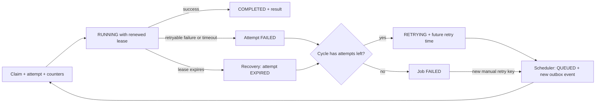

# Reliability — Phase 5

The platform now executes both `ECHO` and `SIMULATED_WORK`, renews active leases,
times out attempts, schedules retries, recovers abandoned claims, and accepts
idempotent manual retry requests. Enable messaging using **Run platform** or
`MESSAGING_ENABLED=true` as described in [README.md](../README.md).

## What happens when work fails?



Each cycle has **four total claimed attempts**, including its initial attempt.
Retryable failures after cycle attempts 1, 2, and 3 set retry times **1, 2, and 4
seconds** in the future. Polling and queue delays can add latency; these are
minimum backoff delays, not exact start appointments. Attempt 4 failure makes the
job `FAILED`. A permanent validation/configuration error stops earlier.

Failure recording commits the attempt outcome, job state, retry/completion time,
and cleared lease together, then the old delivery is ACKed. The retry scheduler
later locks/rechecks due jobs and commits `QUEUED` plus exactly one new outbox
event for that transition. It does not requeue the old delivery as a delay tool.

Lease recovery uses the same cycle budget. A committed claim consumes a slot
even if the process dies before calling its handler. Failed/uncommitted claims
do not increment counters. Candidate scans are capped at 100 by default; every
transition rechecks current state while holding the job lock. Competing pollers
cannot independently queue/recover the same transition twice.

## Simulation

```json
{
  "type": "SIMULATED_WORK",
  "payload": {"durationMillis": 1000, "failFirstAttempts": 2}
}
```

The handler cooperatively waits for the duration, then reports retryable
`SIMULATED_FAILURE` on the first two attempts **of the current cycle**. Attempt 3
succeeds with a result such as:

```json
{"durationMillis":1000,"cycleAttempt":3,"message":"Simulated work completed"}
```

This simulation does not call real external services and does not demonstrate
idempotency for payments/email/etc. The platform, not the handler, owns backoff,
budget, and retry scheduling. Phase 4's previously deferred simulation outbox
records are now eligible without recreating jobs or changing their saved API
acceptance outcomes. Corrupt stored simulation settings fail permanently as
`INVALID_PAYLOAD`; missing values are not silently treated as zero.

## Lease renewal and runtime limit are separate

| Control | Production default | Meaning |
| --- | --- | --- |
| Initial/renewed lease | 30 seconds | Temporary permission to own this attempt |
| Heartbeat interval | 10 seconds | Renew while still current, running, and unexpired |
| Supervision tick | 1 second | Check ownership/runtime and renew when due |
| Per-attempt runtime | 5 minutes | No endless renewal of stuck work |
| Recovery poll | 10 seconds | Find expired attempts, then lock/recheck them |
| Retry poll | 1 second | Find due retry times, then lock/recheck them |
| Broker ACK timeout | 10 minutes | Independent RabbitMQ delivery/channel safeguard |

Each attempt has its own immutable start timestamp. Runtime checks use it, not
job creation or a previous cycle's start. A dedicated four-thread supervisor and
four-connection PostgreSQL pool perform bounded, short control transactions
separately from the API/handler pool. The control pool has a one-second connection
wait and short statement/transaction timeouts. This prevents ordinary handler
connection use from consuming all heartbeat resources; it does not make a failed
database or a paused process healthy.

Ownership checks lock the job first and then use fresh database time:

```sql
SELECT job_id FROM job_platform.jobs WHERE job_id = :job_id FOR UPDATE;
-- Recheck RUNNING, current attempt, and lease_expiry > clock_timestamp().
-- Renew only if still authorized; never revive an expired lease.
```

At runtime expiry, supervision commits a retryable `TIMEOUT` outcome if still
authorized, stops renewal, and requests cancellation. Success persistence itself
also checks the runtime deadline after locking, closing the gap if a process
pauses between supervision and result storage. A late success is rejected and
recorded as a timeout if the same attempt still has a valid lease; once the lease
has expired, recovery owns the transition instead.

Handlers run on synchronous bounded consumer slots. Cancellation requests do not
free a slot until its handler actually exits. The current simulation checks a
cancellation flag and uses interruptible waits. Java cannot safely force-stop
arbitrary uncooperative handlers; a broker ACK timeout closes/requeues a channel,
**not** the stuck Java code. Database ownership prevents stale state writes;
downstream business idempotency and external-call timeouts remain necessary.

On supervision/database uncertainty, stop renewing and request cancellation, do
not pretend a result was saved. Worker intake pauses with capped infrastructure
backoff; redelivery checks authoritative state and lease recovery progresses
abandoned attempts. Persistence errors do not directly authorize rerunning the
same active attempt. Shutdown cancels local supervision and prevents delayed
consumer restarts; retained leases/outbox state support later recovery.

## Recovery example

1. Worker A commits claim A1, then its process dies.
2. Its heartbeat stops and its lease expires.
3. Recovery locks J1, confirms A1 is still the expired owner, marks A1 `EXPIRED`,
   and schedules retry (or makes the job `FAILED` if the cycle is exhausted).
4. The retry scheduler queues J1 through a new outbox event.
5. Worker B claims A2 and continues. A resumed A1 cannot complete/fail/renew A2.

Recovery does not require the crashed consumer's original notification to survive
as a specific delivery; committed job/lease/retry state owns progress.

## Manual retry and history

```http
POST /jobs/<job-id>/retry
Content-Type: application/json
Idempotency-Key: manual-cycle-1

{}
```

Body may be absent or an empty object; the operation does not replace the job's
type or payload. Scope is `RETRY_JOB:<canonical-job-uuid>` with `local-client`.

- A saved matching scoped key returns its original response **before checking
  current eligibility**, even if the job has since run, completed, or failed.
- A new key on a `FAILED` job accepts a fresh four-attempt cycle with the same
  job ID. Queue change, new outbox event, and saved response commit together.
- Reset only `cycle_attempt_count` to zero. Clear the current-cycle job start,
  completion, retry, and lease timestamps; preserve creation, payload, lifetime
  counter, and all historical attempts. Create no attempt until the next claim.
- A new key on an existing non-failed job returns **409**/`JOB_NOT_FAILED` without
  reset or new event. Different-key requests racing for the same failed job
  take turns under its lock: once it has left `FAILED`, a new retry conflicts.
- Unknown job returns **404**; malformed UUID/input/key is **400**. Well-formed
  retry-operation error outcomes are saved for replay too. To retry a previously
  rejected operation after conditions change, use a new key.
- Multiple manual cycles are allowed. Reusing an old accepted key never starts
  a new cycle. Changed input under that saved key returns **409** key-reuse error.

Example numbering:

```text
Initial cycle: attempts 1,2,3,4 -> FAILED
Manual key A accepted: lifetime=4, cycle=0, no new attempt yet
Next claims: attempts 5,6,7,8 -> FAILED again
Repeat key A: original 202 response only, job stays FAILED
New key B: fresh cycle; next historical attempt will be 9
```

`GET /jobs/{id}` now includes ordered `attempts` with attempt IDs/numbers, worker,
status, start/end, and failure type/reason. The top-level failure summary still
describes relevant current-cycle failed/retrying work, not an old failure shown
as a new running/successful job's error. Full pagination of very long history is
future work; this local API is not an authenticated multi-tenant service.

## Configuration

Production defaults are in [application.yml](../src/main/resources/application.yml).
The following properties are configurable through Spring configuration:

```properties
platform.reliability.heartbeat-ms=10000
platform.reliability.control-interval-ms=1000
platform.reliability.max-runtime-ms=300000
platform.reliability.retry-base-ms=1000
platform.reliability.retry-poll-ms=1000
platform.reliability.recovery-poll-ms=10000
platform.reliability.pollers-enabled=true
```

The base retry delay multiplies by 1, 2, and 4. Keep heartbeat intervals shorter
than the configured lease and control checks frequent enough for that allowance.
Do not shrink production timings merely to make test runs fast; tests override
their isolated contexts explicitly. API-only mode still accepts durable work and
manual retry operations, but polling/execution waits until messaging is enabled.

## What was tested

The suite includes real PostgreSQL/RabbitMQ flows for simulated failures and
completion, exhaustion followed by another manual cycle, a job running beyond
its initial lease with renewal, timeout interruption/exhaustion, and abandoned
claim recovery. One test launches a **separate actual worker JVM**, kills it
forcibly after a committed claim, then verifies `EXPIRED -> replacement COMPLETED`
under the surviving platform. It does not kill the user's running development
application or touch its persistent database.

Additional tests cover default 1/2/4-second backoff bounds, recovery exhaustion,
expired-owner renewal rejection, competing scheduler/recovery transitions,
outbox/attempt-write rollback, runtime rejection at completion, heartbeat access
with every primary-pool connection occupied, uncertain supervision cancellation,
manual same/different-key races, and preserved attempt history. Timing-focused
tests use shortened settings or controlled test timestamps; they are not a claim
that a five-minute wall-clock soak or load benchmark has been run.

## Still outside the guarantee

This is at-least-once execution with finite automatic budgets, not guaranteed
business success or exactly-once external actions. Permanent data loss, corrupt/
deleted volumes, and redundant-host high availability remain outside V1. Phases
6–8 still cover dashboards/expanded observability, sustained load/failure
experiments, and scaling. These reliability tests do not establish the target
1,000 jobs/second or 99.9% availability.