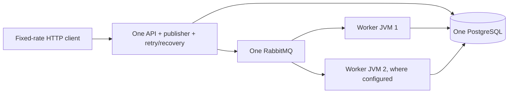

# Local scaling — Phase 8

**Completed scope:** measured local multi-worker execution, equal-slot tuning,
publication-polling tradeoffs, and verified container packaging. **Kubernetes,
multi-host deployment, HA and maximum capacity remain deferred**, not silently
counted as implemented. Adding replicas does not change the intact-storage V1
failure scope or make external effects exactly-once.

Read [the measured results and backlog chart](benchmarks/2026-10-25-scaling.md)
before interpreting the presence of multiple processes as proof of scaling.

## Experiment layout

Workers use existing independent claim/attempt/lease rules. No new scheduler,
distributed lock, worker coordinator, handler or schema is introduced.

- The API JVM disables only worker consumption. It owns one publisher and the
  retry/recovery pollers. This keeps those roles fixed as workers are added.
- Worker JVMs disable publishing and retry/recovery polling; each still supervises
  its own attempts. They use the same database and durable queue.
- Every process has a ten-connection primary pool and a separate four-connection
  supervision pool. Adding processes multiplies the connection budget; the control
  pool is lazily used and the publisher-only JVM normally does not need it.
- No worker holds a DB transaction during the simulated one-second handler wait.
  Atomic claim plus the per-job attempt constraints still choose one owner.
- Separate worker health endpoints bind random localhost ports in the experiment.
  Metrics IDs remain log-only; the report reads stored `worker_id` history to check
  that both workers participated and every accepted job completed exactly once in
  the no-failure cohort. This does not change the architecture's at-least-once model.

## Repeat the comparisons

Use Java 21, Python 3.9+ and Docker Desktop. Run **Verify project (Java 21, macOS)**
and **Verify benchmark runner**, then **Run isolated scaling comparisons (Java 21,
macOS)** from VS Code tasks.

The [scaling runner](../tools/scaling.py) reuses
[the Phase 7 measurement contract](performance.md): bounded fixed-rate arrivals,
full error/drop accounting, distinct completion/drain windows, explicit
creation-to-first-start approximation and retained raw evidence. Each scenario
gets **fresh disposable dependencies**, one API JVM and its configured worker
JVMs. It starts with only its fifty completed warm-up jobs, never the previous
scenario's data. The original development app/monitoring remain running.

| Scenario | Worker processes × slots | Workload | Offered/s | Publisher fixed delay |
| --- | --- | --- | ---: | ---: |
| One-worker baseline | 1 × 10 | One-second simulation, no failures | 15 | 1000ms |
| Scale out | 2 × 10 | Same simulation | 15 | 1000ms |
| Equal-slot control | 1 × 20 | Same simulation | 15 | 1000ms |
| Scaled overload | 2 × 10 | Same simulation | 25 | 1000ms |
| Publication-wait baseline | 2 × 10 | Fixed ECHO payload | 15 | 1000ms |
| Publication-wait tuning | 2 × 10 | Same ECHO payload | 15 | **100ms, experiment only** |

Defaults: ten-second warm-up at 5/s, sixty-second measured arrival window,
180-second drain limit, sixteen request threads, 32 maximum outstanding requests.
CLI scenario selection allows running individual comparisons; duplicate scenarios
are rejected to avoid benchmarking request-key replay.

PostgreSQL/RabbitMQ each keep a one-CPU/768MiB limit across cases. Each host JVM
has 256–512MiB heap and `ActiveProcessorCount=2`, **not** an OS CPU quota. More JVMs
therefore add heap, threads, pools and potential host CPU use: not a constant-total-
resource scaling efficiency experiment. One twenty-slot worker is a useful local
control but does not prove one process is always preferable.

Reports under the ignored build output include metadata/hashes, per-role runtime
samples, database connections/lock waits, broker statistics, raw request/history
JSON, readable comparison and backlog SVG. Pool/CPU/worker snapshots are not
atomic with each other and can miss short spikes. A zero sampled lock wait is not
proof of zero contention. HTTP observation failure is explicit, never a false zero.

Worker death or a failed required SQL observation aborts the experiment; HTTP
observer failures are recorded separately and do not automatically invalidate the
workload's cohort checks. Evaluate telemetry completeness independently from
job correctness. On experiment failure, dependency state/logs are captured before
owned-resource cleanup where possible. Every child is stopped/reaped before
dependencies are removed. A dropped-arrival run is retained as invalid, not
presented as though the offered workload was met. See the measured report for
the failed high-ECHO attempts in this session.

## Resource and bottleneck lessons

| Layout | JVMs including API | Maximum heap budget | Configured DB connection maximum |
| --- | ---: | ---: | ---: |
| One worker | 2 | 1024MiB | 2 × (10+4) = 28 |
| Two workers | 3 | 1536MiB | 3 × (10+4) = 42 |

Actual connections in these runs were lower (see report), because control pools
are lazy. The primary pools are per-process, not a global budget. Revisit the DB's
connection limit before adding many replicas; PgBouncer/new infrastructure is not
automatically required or added here. A second process also adds another snapshot
query and JVM runtime; global database gauges must not be summed across instances.

Ten one-second slots saturated at 15/s. Twenty slots kept up at that offer, while
25/s still grew backlog. At the higher offer, sampled pool wait and elevated
client latency showed additional resource pressure; no profiler or CPU-causality
proof is claimed. Polling tuning reduced low-load ECHO start waiting, but costs
more empty/short DB polls and is **not** a measured maximum-throughput improvement.
The application defaults remain unchanged.

## Run the application in containers

[Dockerfile](../Dockerfile) packages the **already-verified executable JAR** using
a verified multi-platform Java 21 JRE pinned by content digest. It runs as numeric
user/group **10001:10001**. The minimal build context contains no credentials,
source tree or raw benchmark logs. No Maven download/build occurs inside this
runtime image. A changed JAR requires rebuilding the image.

The independent [compose.workers.yaml](../compose.workers.yaml) deployment adds:

- its own PostgreSQL and RabbitMQ named volumes and local-only initial passwords;
- one API/publisher with worker consumption disabled;
- scalable worker containers with publishing/pollers disabled;
- one CPU/512MiB per application container, read-only root filesystem, writable
  temporary directory, dropped capabilities and no-new-privileges;
- API bound to **localhost:8081**, no published worker/database/broker ports.

Use **Start standalone container platform (two workers)** only after verifying
the JAR. This standalone project does **not** merge with the development Compose
project. Its API/worker resource limits differ from the host-JVM benchmark: the
smoke test is packaging/correctness evidence, **not** a comparable capacity run.

Use **Stop standalone container platform (preserve data)** to stop it. This keeps
its named volumes. The default standalone project was **not** left running by
these experiments; the development application still owns port 8080. Do not use
volume deletion as an ordinary stop procedure. Credentials are local development
defaults only; authentication/secrets management and production hardening are
not supplied by this milestone.

**Verify container platform (disposable two-worker smoke)** builds/starts the same
deployment under a unique UUID Compose project, with a random localhost API port.
It verifies the non-root/read-only/resource limits and twenty one-second jobs
shared by two workers, then removes **only that disposable project's** containers
and volumes. It does not remove persistent development/standalone volumes.

## Validation and deferred work

- Full Java regressions: **173 passing**, no failures/errors/skips.
- Python generator/scaling/container orchestration checks: **71 passing**.
- Six valid measured scenarios: all **6,000 selected jobs** eventually completed
  correctly with one recorded attempt each and no dropped arrivals/unknown commits.
- Real container deployment smoke: twenty jobs/results, twenty attempts and two
  worker identities; three non-root/read-only/resource-limited application containers.
- Development services remained healthy with original data; disposable projects
  and benchmark containers were removed. Runtime image is available locally.

**Deferred:** Kubernetes manifests/cluster experiments, multi-host HA, autoscaling,
long-duration soak, maximum-capacity search, exact commit-to-start instrumentation,
shared-pool tuning and production authentication. Completing this local milestone
does not claim these exist, that every target was met, or that learning work is
exhausted. Kubernetes should be a separately requested deployment experiment with
explicit resource/storage/network assumptions, not an unmeasured scaling claim.